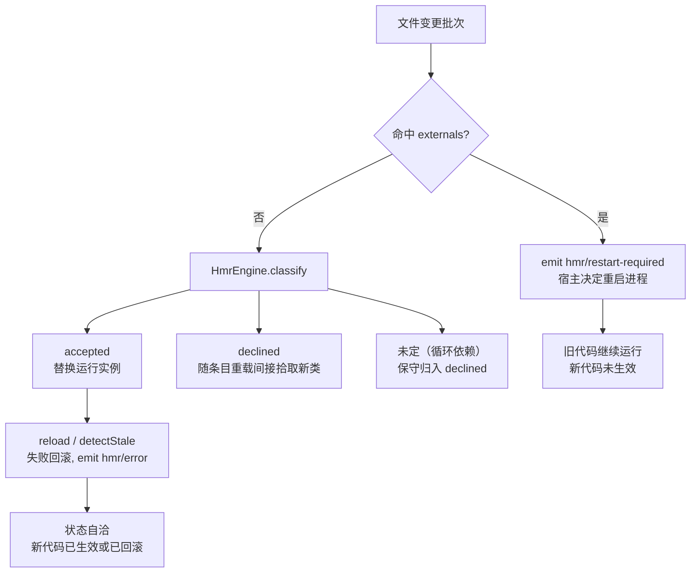

热更新（HMR）并不是“任何文件改动都能原地换血”。cordis-java 用一套**保守的分类机制**把文件改动分成三类：可热换的 accepted、拒热换但可随重载更新的 declined、以及需要整体重启的 externals。本页聚焦这条“适配边界”的精确形状：externals 如何被排除在热换之外、`hmr/restart-required` 事件如何把重启决策交还宿主，以及源码模块模型明确不覆盖的场景。

## externals：热换边界的“硬墙”

`HotReloadService` 允许在构造时传入一组 externals 路径。构造函数会立即把每个路径通过解析器的 `url()` 规范化为 file URI，存成不可变集合——也就是说 externals 是**文件粒度**的白名单外清单，与被监听的 `.java` 源文件同一坐标系比较：

```java
this.externals = externals.stream()
    .map(p -> Path.of(java.net.URI.create(resolver.url(p))))
    .collect(Collectors.toUnmodifiableSet());
```

防抖批处理触发时，若本批次中任何一个文件命中 externals，服务**不做任何编译或替换**，直接向加载器上下文发出 `hmr/restart-required` 事件并返回：

```java
if (batch.stream().anyMatch(externals::contains)) {
    loader.context().emit("hmr/restart-required", batch);
    return;
}
```

注意这个短路发生在 `reloadNow()` 之前——externals 的语义是“这批改动我不敢热换，整个批次交给宿主重启”，而不是“只跳过这个文件、其余照常热换”。这是刻意的保守设计：混批处理可能导致新旧代码在同一代 ClassLoader 中交错。

Sources: [HotReloadService.java](cordis-core/src/main/java/dev/cordis/hmr/HotReloadService.java#L38-L43), [HotReloadService.java](cordis-core/src/main/java/dev/cordis/hmr/HotReloadService.java#L91-L96)

## classify：externals 在分类不动点中的地位

`HmrEngine.classify` 是模块分类的核心。它从变更集（stashed）出发做**不动点迭代**：引用到 accepted 模块的被纳入 accepted；依赖全部落在 declined 的被归入 declined；循环引用中始终定不下来的按 declined 处理。而 externals 在迭代开始前就被直接放入 declined 集合，并在后续 traverse 中作为**边界**——依赖遍历遇到 declined 即停：

```java
Set<String> accepted = new LinkedHashSet<>(stashed);
Set<String> declined = new LinkedHashSet<>(externals);
accepted.removeAll(declined);
```

这意味着即使某个源码模块 import 了一个 external 文件，它也**永远不会被 accepted**。测试 `externalsAreNeverAccepted` 精确锁定了这个语义：

```java
// imports: app → changed（changed 是变更文件，app 是 external）
Classification c = HmrEngine.classify(Set.of("changed"), Set.of("app"), g);
assertFalse(c.accepted().contains("app"));
assertTrue(c.declined().contains("app"));
```

declined 模块的待遇与 accepted 不同：它们不会被“替换运行实例”，但会随所在配置条目的重载**间接拾取新类**（陈旧检测时整个依赖树作废重装）。externals 与普通 declined 的差别只在于：externals 的变化由 `HotReloadService` 拦截并升级为 restart-required，而普通 declined 变化仍走正常热换流程。

Sources: [HmrEngine.java](cordis-core/src/main/java/dev/cordis/hmr/HmrEngine.java#L52-L72), [HmrTest.java](cordis-core/src/test/java/dev/cordis/HmrTest.java#L63-L70), [HmrEngine.java](cordis-core/src/main/java/dev/cordis/hmr/HmrEngine.java#L77-L85)

## restart-required：宿主拥有重启决策权

`hmr/restart-required` 事件的 payload 是发生变化的文件批次的不可变快照。发出后服务不做任何清理或回滚——因为**没有任何状态被改动**，旧插件仍在运行，事件监听方（宿主应用）可以自行决定：立即退出进程、提示用户、或在合适时机调用 `System.exit`。README 明确了这一契约：“这些文件变化发出 `hmr/restart-required`，由宿主决定如何重启进程”。

这与失败回滚路径上的 `hmr/error` 事件形成对照：`hmr/error` 表示热换已尝试且已回滚，进程状态是自洽的；`hmr/restart-required` 则表示框架主动放弃处理，状态保持原样但**新代码未生效**。

Sources: [HotReloadService.java](cordis-core/src/main/java/dev/cordis/hmr/HotReloadService.java#L91-L99), [README.md](README.md#L155-L156)

## 明确不支持的场景

适配边界的另一半是“HMR 覆盖什么”。当前源码模块模型有如下硬性约束，来自 `JavaModuleResolver` 的实现：

| 约束 | 依据 | 越界时的行为 |
|---|---|---|
| 模块必须是一个 `.java` 源文件 | `scan()` 只收集 `*.java`，类名 = 包名 + 文件名 | 文件不出现在 `urls()` 中，重载计划直接跳过 |
| 必须实现 `Plugin` 接口 | `Generation.resolve` 显式校验 | 抛出 `IllegalArgumentException("Module does not implement Plugin")` |
| 需要无参构造实例化 | Generation 内反射创建插件 | 实例化失败即重载失败，走回滚 |
| 需要 JDK 而非 JRE | `ToolProvider.getSystemJavaCompiler()` | 抛出 `IllegalStateException("HMR requires a JDK, not a JRE")` |
| 依赖来自宿主 classpath | `hostClasspath()` 收集 `java.class.path` 与 `Plugin` 类所在位置 | 不支持任意 JAR 动态下载；需要额外依赖时显式给构造器传 classpath |

Sources: [JavaModuleResolver.java](cordis-core/src/main/java/dev/cordis/loader/JavaModuleResolver.java#L29-L44), [JavaModuleResolver.java](cordis-core/src/main/java/dev/cordis/loader/JavaModuleResolver.java#L155-L166), [JavaModuleResolver.java](cordis-core/src/main/java/dev/cordis/loader/JavaModuleResolver.java#L206-L210), [README.md](README.md#L159-L163)

此外，README 明确列出了**协议层**的不覆盖项：不提供 Node ESM/CJS 缓存兼容（Java 端没有 require 缓存可 hack，等价物是逐代 ClassLoader）、不迁移运行中对象的字段（换模块 = 卸旧 fiber + 挂新 fiber，效应回滚重放，对象状态不跨代搬运）、不回滚外部数据库事务（逆操作正确性由组件的 Disposable 保证，见 [效应与资源回退](6-xiao-ying-yu-zi-yuan-hui-tui-disposable-lifo-ni-cao-zuo-yu-shi-bai-bu-zu-duan-qing-li)）。

Sources: [HmrEngine.java](cordis-core/src/main/java/dev/cordis/hmr/HmrEngine.java#L15-L21), [README.md](README.md#L159-L164)

## 三个适配边界的全景



这张图的核心区分是**三条终点线的语义差异**：`hmr/restart-required` 意味着框架放弃、宿主接管；`hmr/error` 意味着尝试失败但已恢复；正常重载完成则意味着新代码已生效。理解这条边界，是判断“我的改动会不会热换、需不需要重启”的唯一依据。

## 实践建议

- **externals 应包含所有“结构性”文件**：被大量模块共享、且改动意味着接口/协议变化的文件。放进去之后，改动它就天然升级为重启信号，避免热换出一个语义错乱的混合代。
- **依赖外部库时不要指望 HMR 拾取**：classpath 在解析器构造时固定（`hostClasspath()` 读取 `java.class.path`），新增 JAR 需要重建应用或显式传入新 classpath。
- **长时间开发会话应定期重建**：旧代 ClassLoader 与编译产物保留到解析器 close 以支持回滚和延迟类加载，因此内存会随代数增长。

Sources: [HotReloadService.java](cordis-core/src/main/java/dev/cordis/hmr/HotReloadService.java#L38-L44), [JavaModuleResolver.java](cordis-core/src/main/java/dev/cordis/loader/JavaModuleResolver.java#L29-L44), [README.md](README.md#L164-L165)

若要继续深入，推荐阅读 [HmrEngine 事务性替换：模块分类、失败回滚与陈旧条目检测](18-hmrengine-shi-wu-xing-ti-huan-mo-kuai-fen-lei-shi-bai-hui-gun-yu-chen-jiu-tiao-mu-jian-ce) 了解 accepted/declined 分类的完整算法，以及 [保守引用分析：为什么热更新会重载整个源码目录](19-bao-shou-yin-yong-fen-xi-wei-shi-yao-re-geng-xin-hui-zhong-zai-zheng-ge-yuan-ma-mu-lu) 理解依赖图为何“宁可多换不可混用”。