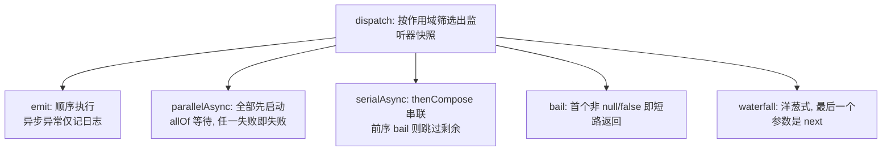
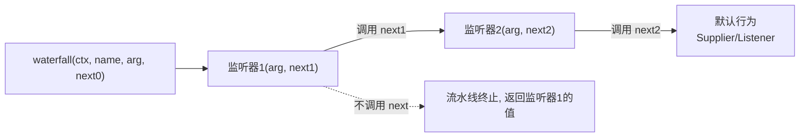

cordis-java 内置了一个挂载在根上下文上的发布/订阅事件总线 —— `EventsService`。它的设计有三个鲜明的特点：监听器是**受管效应**（随运行实例卸载自动移除）、派发遵循**上下文冒泡规则**、并且提供了五种覆盖同步/异步场景的派发模式。本文剖析其实现机制与各派发模式的语义差异。

## 总体架构：根上下文上的单例总线

`EventsService` 在根上下文创建时实例化一次（`Context.java:75`），所有上下文通过 `ctx.events()` 共享同一个总线实例。核心数据结构是一个 `Map<String, List<Hook>>`，其中每条 `Hook` 记录了注册所在的上下文与回调，并带有一个 `global` 标志区分全局监听器。

```mermaid
flowchart LR
    subgraph Root["根上下文 Context.createRoot()"]
        ES["EventsService<br/>hooks: Map&lt;name, List&lt;Hook&gt;&gt;"]
    end
    A["ctxA.on(&quot;evt&quot;, l1)"] -->|Hook{ctx=A}| ES
    B["ctxB.on(&quot;evt&quot;, l2)"] -->|Hook{ctx=B}| ES
    G["ctxB.onGlobal(&quot;evt&quot;, l3)"] -->|Hook{global=true}| ES
    E["ctxA.emit(&quot;evt&quot;)"] -->|冒泡筛选| ES
```

监听器的注册本身就是一次效应注册：`on` 会调用 `ctx.fiber().effect(...)`，把"加入监听列表”登记为 fiber 的效应，效应回退动作就是从列表中移除该 hook。这意味着插件运行实例卸载时，它注册的所有监听器会被 LIFO 自动清理，无需手动反注册。Sources: [EventsService.java](cordis-core/src/main/java/dev/cordis/core/runtime/EventsService.java#L20-L65), [Context.java](cordis-core/src/main/java/dev/cordis/core/runtime/Context.java#L336-L351)

## 作用域：冒泡规则与全局监听器

派发时的筛选由 `accepts` 实现：从派发上下文出发沿父链向上遍历，只要命中 hook 注册时的上下文即接收。也就是说，**在上下文 A 上注册的监听器能收到 A 及其所有子孙上下文发出的事件**——这是"子发父收"的冒泡模型，而非"父发子收"的广播模型。

两条路径可以绕过冒泡：`dispatchCtx == null`（框架内部以 `null` 派发的全局内部事件，如 `internal/status`、`internal/plugin`）或 hook 标记为 `global`（通过 `onGlobal` 注册，任何派发都接收）。此外 `dispatchLocked` 中有一条特例：`internal/update` 与 `internal/config` 这两个事件只派发给与派发方**同一 fiber** 的监听器，防止配置更新瀑布被无关插件劫持。Sources: [EventsService.java](cordis-core/src/main/java/dev/cordis/core/runtime/EventsService.java#L85-L110), [Context.java](cordis-core/src/main/java/dev/cordis/core/runtime/Context.java#L343-L344)

| 注册方式 | 接收范围 | 典型用途 |
|---|---|---|
| `ctx.on(name, l)` | `name` 事件从 ctx 或其子孙发出时 | 组件监听自己子树的事件 |
| `ctx.onGlobal(name, l)` | 任何派发（含 `emit(null, ...)`） | 框架级横切关注，如 `ComponentLoader` 监听 `internal/config-updated` |

框架自身大量依赖这套机制：`ComponentLoader` 用 `onGlobal` 订阅 `internal/config-updated` 与 `internal/plugin` 实现调和，`ConfigWatcher` 用 `onGlobal` 订阅 `loader/config-open`，Fiber 状态机则通过 `emit(null, "internal/status", ...)` 广播生命周期变化。Sources: [ComponentLoader.java](cordis-core/src/main/java/dev/cordis/loader/ComponentLoader.java#L51-L61), [Fiber.java](cordis-core/src/main/java/dev/cordis/core/runtime/Fiber.java#L380-L390)

## once：一次性监听器的实现

`once` 是建立在 `on` 之上的组合：包装回调在首次触发时先调用返回的 `Disposable` 自我反注册，再执行用户逻辑。由于反注册走的是效应回退链（从 hook 列表中移除），`once` 与 fiber 卸载的清理语义天然兼容——既可被事件触发销毁，也可被卸载销毁。测试验证了其语义：同一事件 emit 两次，计数器只增加一次。Sources: [EventsService.java](cordis-core/src/main/java/dev/cordis/core/runtime/EventsService.java#L76-L83), [ContextExtensionTest.java](cordis-core/src/test/java/dev/cordis/ContextExtensionTest.java#L78-L88)

## 五种派发模式对比



| 模式 | 签名返回 | 并发 | 返回值语义 | 异常处理 |
|---|---|---|---|---|
| `emit` | `void` | 顺序同步 | 忽略 | 同步异常记日志不打断他人；`CompletionStage` 结果的异常经 `whenComplete` 记日志 |
| `parallelAsync` | `CompletionStage<Void>` | 并行（先全部启动） | `allOf` 聚合 | 每个监听器独立包装为 future，等全部完成后抛第一个错误 |
| `serialAsync` | `CompletionStage<Object>` | 串行链 | 最后一个监听器的结果 | 同步异常转为 failed future；前序结果命中 bail 条件则跳过后续 |
| `bail` | `Object` | 顺序同步 | 首个"到此为止"的值或 `null` | 直接向上抛出 |
| `waterfall` | `Object` | 洋葱式嵌套 | 最内层/最后触达的值 | 由监听器与 next 自行控制 |

值得注意的是 `isBailed` 的判定：`value != null && !Boolean.FALSE.equals(value)`——即只有 `null` 和 `Boolean.FALSE` 表示"不拦截，继续走"，任何其他非空值都被视为短路信号。这与 `parallelAsync` 的"全部启动后即使有人失败也等待其余完成"语义（见 `parallelEventWaitsForAllListeners` 测试：a 失败后 `done` 未完成，直到 b 完成才整体失败）共同构成了异步派发的边界行为。Sources: [EventsService.java](cordis-core/src/main/java/dev/cordis/core/runtime/EventsService.java#L112-L187), [AsyncLifecycleTest.java](cordis-core/src/test/java/dev/cordis/AsyncLifecycleTest.java#L197-L207)

## waterfall：洋葱式拦截的核心

`waterfall` 是框架实现可插拔拦截的关键。调用时参数数组的**最后一个元素**不是传给监听器的参数，而是"最里层的默认行为"（可以是 `Listener` 或 `Supplier`）。每个监听器会在参数末尾额外收到一个 `next`（`Supplier<Object>`），只有显式调用 `next` 才会继续执行后续监听器直至最内层默认行为；不调用即等于否决整条流水线。



实现上通过 `ArrayDeque` 逐层弹出监听器、用 `Arrays.copyOf` 把 `next` 追加到参数尾部，构成递归的 `waterfallStep` 链。框架用它承载两个核心协议：

- **配置解析**：`Fiber.resolveConfig` 以 `waterfall(ctx, "internal/config", raw, () -> raw)` 让插件有机会改写原始配置，最内层 `Supplier` 保证无人改写时返回原值，之后还可能经过插件 `schema().validate` 校验。Sources: [Fiber.java](cordis-core/src/main/java/dev/cordis/core/runtime/Fiber.java#L389-L394)
- **配置热更新确认**：`Fiber.update` 以 `waterfall(ctx, "internal/update", candidate, Boolean.FALSE, () -> { ...应用更新... })` 实现"默认放行"的确认链——只有所有监听器都调用 `next`，配置变更才真正落盘并广播 `internal/config-updated`；任一监听器拒绝调用 `next` 即可否决更新，返回值还会被转换为 `updateBarrier` 影响后续 `awaitAsync` 的完成时机。Sources: [Fiber.java](cordis-core/src/main/java/dev/cordis/core/runtime/Fiber.java#L436-L452)

## 面向使用者的 API 一览

业务代码通常只接触 `Context` 上的门面方法；五种派发模式中 `Context` 直接暴露了 `on`/`onGlobal`/`emit`/`once`，异步与瀑布模式可通过 `ctx.events()` 拿到完整服务。

| API | 所在 | 说明 |
|---|---|---|
| `ctx.on(name, listener)` | [Context.java](cordis-core/src/main/java/dev/cordis/core/runtime/Context.java#L336-L338) | 注册随 fiber 卸载自动移除的监听器 |
| `ctx.onGlobal(name, listener)` | [Context.java](cordis-core/src/main/java/dev/cordis/core/runtime/Context.java#L343-L344) | 注册全局监听器 |
| `ctx.emit(name, args...)` | [Context.java](cordis-core/src/main/java/dev/cordis/core/runtime/Context.java#L350-L351) | 从本上下文派发（冒泡给祖先监听器） |
| `ctx.once(name, listener)` | [Context.java](cordis-core/src/main/java/dev/cordis/core/runtime/Context.java#L397) | 一次性监听器 |
| `events().parallelAsync / serialAsync / bail / waterfall` | [EventsService.java](cordis-core/src/main/java/dev/cordis/core/runtime/EventsService.java#L140-L205) | 高级派发模式 |

选择建议：通知型场景用 `emit`（失败隔离最好）；需要等待所有异步监听器完成用 `parallelAsync`（注意其"等全部完成再抛第一个错误"的聚合语义）；需要把前一个监听器的结果传给下一个用 `serialAsync`；权限/查找类"命中即返回"用 `bail`；需要拦截-放行语义（如配置改写、更新确认）用 `waterfall`。

了解监听器如何作为效应参与生命周期清理，可继续阅读 [效应与资源回退：Disposable、LIFO 逆操作与失败不阻断清理](6-xiao-ying-yu-zi-yuan-hui-tui-disposable-lifo-ni-cao-zuo-yu-shi-bai-bu-zu-duan-qing-li)；事件总线支撑的配置热更新协议详见 [配置回写与原子写文件：fiber.update 的持久化协议](15-pei-zhi-hui-xie-yu-yuan-zi-xie-wen-jian-fiber-update-de-chi-jiu-hua-xie-yi)。