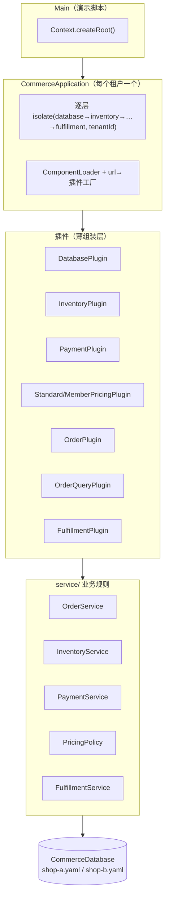
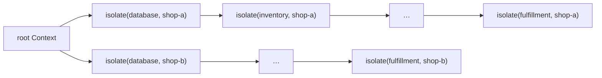
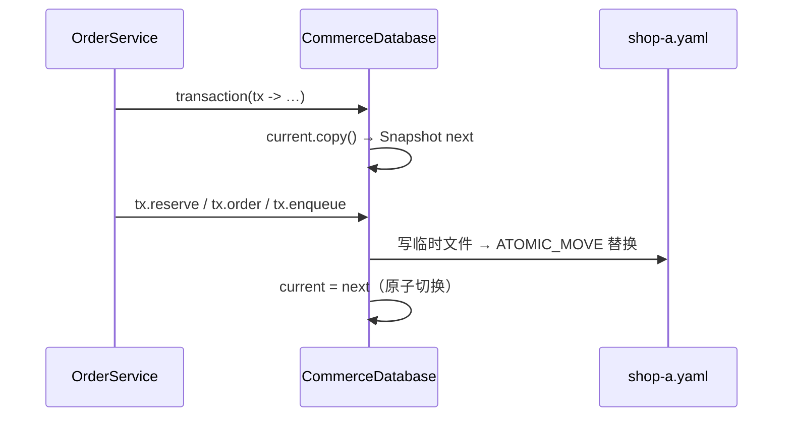

`cordis-example` 是一个可直接运行的多租户电商结算流程，用于演示 cordis-java 的插件生命周期、响应式依赖、上下文隔离与服务拦截在真实业务下的组合方式。本文聚焦示例的**架构分层**：各插件的职责边界、`CommerceApplication` 如何组装服务，以及作为外部系统替身的本地沙箱适配器（文件数据库与沙箱支付/仓配）的设计。运行步骤与业务行为细节请参见 [电商订单示例：运行与业务流程导览](4-dian-shang-ding-dan-shi-li-yun-xing-yu-ye-wu-liu-cheng-dao-lan) 与 [可观察的业务行为：幂等、补偿、降级与促销热替换](24-ke-guan-cha-de-ye-wu-xing-wei-mi-deng-bu-chang-jiang-ji-yu-cu-xiao-re-ti-huan)。

## 架构分层与模块地图

示例采用四层结构，框架只负责“运行资源的装配与撤销”，业务规则与持久化完全落在普通 Java 代码中：

| 层 | 位置 | 职责 |
|---|---|---|
| 演示入口 | `Main.java` | 构造根上下文、创建两个租户、执行可校验的演示脚本 |
| 组合层 | `CommerceApplication.java` | 租户上下文隔离、插件目录声明、运营操作（停用/热替换/审计视图） |
| 业务规则层 | `service/` | 结算编排、库存、支付、定价、仓配等有状态服务 |
| 领域与适配器 | `domain/Commerce.java`、`persistence/CommerceDatabase.java` | 不可变领域记录；本地文件持久化适配器 |

插件本身（`plugins/` 包）刻意保持极薄——每个插件只做三件事：声明 `inject()` 依赖、在 `apply()` 中组装服务、通过 `ctx.provide/effect/onGlobal` 登记。业务逻辑全部在 `service` 包的普通类中，因此插件可以随时被卸载或替换，而服务与数据不受影响。

Sources: [CommerceApplication.java](cordis-example/src/main/java/dev/cordis/example/CommerceApplication.java#L1-L57), [Main.java](cordis-example/src/main/java/dev/cordis/example/Main.java#L15-L20)

## 租户上下文与服务组装

`CommerceApplication` 是理解示例组装方式的核心。构造时它沿一条链逐层调用 `root.isolate(service, tenantId)`，为七个服务名各创建一个以租户 ID 为键的隔离域，最终得到一个租户私有的 `Context`。两个店铺（shop-a / shop-b）使用相同的 SKU 与请求键，但价格、库存、订单与事件互不串用——隔离的粒度由这条链决定。

服务注册通过 `ComponentLoader` 的差分调和完成。`reconcile()` 中的 Entry 列表**有意把消费者排在提供者之前**（orders 在 database 之前），依赖框架的响应式激活语义来驱动顺序：当 `database` 注册后，等待它的消费者自动从 PENDING 激活。调和结束后遍历所有已挂载条目，对每个 fiber 调用 `await()`，保证构造函数返回时全部插件已启动完毕。

运营操作被建模为“修改状态 + 重新调和”：

- `paymentEnabled(false)` / `fulfillmentEnabled(false)`：把对应 Entry 标记为 `disabled` 后再次调和，停用插件；依赖它的 `OrderService` 随之失效。
- `promotion(...)`：修改定价插件配置后重新调和，配置差分更新生效。
- `replacePricing(...)`：走 `HmrEngine.reload` 整体热替换 pricing 插件，这是唯一的运行时替换入口。

Sources: [CommerceApplication.java](cordis-example/src/main/java/dev/cordis/example/CommerceApplication.java#L21-L41), [CommerceApplication.java](cordis-example/src/main/java/dev/cordis/example/CommerceApplication.java#L42-L55)

## 各插件的职责与机制映射

每个插件都是同一模板的变体，差别只在依赖、提供的资源与登记的副作用：

| 插件 | `inject()` 依赖 | `apply()` 中的动作 | 卸载时框架撤销的资源 |
|---|---|---|---|
| DatabasePlugin | — | 打开租户数据库会话，`effect` 注册关闭回调，`provide("database", …)` | 数据库会话（释放文件锁，不删除数据） |
| InventoryPlugin | database | 构造 `InventoryService` | — |
| PaymentPlugin | database | 构造 `PaymentService` | — |
| StandardPricingPlugin | — | `provide("pricing", PricingPolicy)`，带类型化 `Config` 校验 | pricing 服务 |
| MemberPricingPlugin | — | 继承标准策略，改为按金卡门槛折算折扣 | pricing 服务 |
| OrderPlugin | database/inventory/payments/pricing | 构造 `OrderService` 并执行 `recoverPendingPayments()` | checkout 可用性 effect |
| OrderQueryPlugin | database | 构造只读查询服务 | — |
| FulfillmentPlugin | database | 构造 `FulfillmentService`，订阅全局 `order/paid` 事件，启动时补处理积压 outbox | 事件订阅（outbox 数据持久保留） |

三个细节值得注意。其一，`DatabasePlugin` 把关闭会话登记为 effect，这保证了“卸载释放锁、保留业务历史”的语义——文件锁是运行资源，YAML 快照里的订单/支付/出库记录不是。其二，`OrderPlugin.apply` 在组装完成后立即调用 `recoverPendingPayments()`，对应“扣款成功但提交 PAID 状态前中断”的崩溃恢复路径。其三，`FulfillmentPlugin` 的事件订阅随插件卸载自动移除，重新启用时 `dispatchPending()` 会回放 outbox 中未完成的任务——这正是“仓配补处理”行为的机制来源。

Sources: [DatabasePlugin.java](cordis-example/src/main/java/dev/cordis/example/plugins/DatabasePlugin.java#L14-L24), [OrderPlugin.java](cordis-example/src/main/java/dev/cordis/example/plugins/OrderPlugin.java#L9-L20), [FulfillmentPlugin.java](cordis-example/src/main/java/dev/cordis/example/plugins/FulfillmentPlugin.java#L12-L22), [MemberPricingPlugin.java](cordis-example/src/main/java/dev/cordis/example/plugins/MemberPricingPlugin.java#L10-L18)

## 服务层：插件薄、服务厚的实现

`OrderService` 展示了服务如何在框架生命周期之上组织业务规则。它在构造时把插件提供的四个依赖固化进一个 `Runtime` 快照对象，并注册一个 effect：插件卸载时把 `runtime.active` 置为 `false`，此后任何新业务写入都会抛出 `CHECKOUT_UNAVAILABLE`，而 `find/list` 等只读操作同样经过 `available()` 检查——框架只撤销“服务可用性”，不撤销已持久化的订单历史。

它还实现了 `ContextualService<OrderService>`：`inContext(caller)` 返回一个绑定调用者上下文的视图，`writable()` 读取 `interceptConfig()` 中的 `readOnly` 标志。`CommerceApplication.auditOrders()` 通过 `context.intercept("orders", Map.of("readOnly", true))` 注入该标志，使审计角色可查询但不可下单/退款（详见 [intercept 原地更新与租户隔离实战（电商双店铺）](12-intercept-yuan-di-geng-xin-yu-zu-hu-ge-chi-shi-zhan-dian-shang-shuang-dian-pu)）。

结算主流程的补偿边界全部由显式状态转换表达：库存预占与订单写入在同一个 `database.transaction` 中原子提交；支付拒绝时在同一事务中释放库存并落 `PAYMENT_FAILED`；扣款成功后 PAID 状态与 outbox 入队在同一次提交写入——若提交失败，持久的待支付订单与支付回执仍可由 `recoverPendingPayments()` 复用同一支付 ID 恢复，绝不二次扣款。

Sources: [OrderService.java](cordis-example/src/main/java/dev/cordis/example/service/OrderService.java#L22-L32), [OrderService.java](cordis-example/src/main/java/dev/cordis/example/service/OrderService.java#L51-L74), [OrderService.java](cordis-example/src/main/java/dev/cordis/example/service/OrderService.java#L104-L115)

## 本地沙箱适配器：CommerceDatabase 与外部系统替身

`CommerceDatabase` 是示例的持久化核心，明确声明为**演示级适配器而非生产数据库**。它的设计要点：

1. **进程内 copy-on-write 事务**：`transaction()` 先 `current.copy()` 出快照副本，在 `Transaction` 上修改，成功后整体替换 `current`；不支持嵌套事务，`writable=false` 防止事务结束后继续写入。
2. **原子落盘**：`persist()` 写临时文件后 `Files.move(..., ATOMIC_MOVE)` 替换目标，回退到普通 move 保证可移植性。
3. **独占文件锁**：`open()` 对 `xxx.yaml.lock` 执行 `tryLock()`，第二个会话直接失败，防止两个数据库实例覆盖同一份数据。
4. **安全的 YAML 编解码**：写入用 `SnakeYAML` dump，读取用 `SafeConstructor` 并校验 version=1 与 tenantId 匹配。

**沙箱边界**是本文档最重要的结论：支付通道只支持 `test-card`（成功）与 `declined`（拒绝）两个卡号，仓配出库只是本地记录，不访问任何真实支付、短信或物流接口；沙箱支付/退款记录与订单共用本地存储。因此本例中的“事务”只是单文件内的进程内原子性——对接真实外部网关时需要幂等接口、回调验签、对账与分布式失败恢复，不能把本地事务视为跨系统原子事务。框架撤销的是连接、服务注册、事件监听等**运行资源**；已发生的支付与订单属于业务历史，补偿由 `cancel/refund/release` 这类显式规则负责，而不是插件卸载的隐式副作用。

Sources: [CommerceDatabase.java](cordis-example/src/main/java/dev/cordis/example/persistence/CommerceDatabase.java#L14-L45), [CommerceDatabase.java](cordis-example/src/main/java/dev/cordis/example/persistence/CommerceDatabase.java#L131-L172), [CommerceDatabase.java](cordis-example/src/main/java/dev/cordis/example/persistence/CommerceDatabase.java#L196-L216), [cordis-example/README.md](cordis-example/README.md#L52-L61)

## 延伸阅读

- 想逐条观察演示脚本输出的行为（幂等、补偿、降级、租户隔离），见 [可观察的业务行为：幂等、补偿、降级与促销热替换](24-ke-guan-cha-de-ye-wu-xing-wei-mi-deng-bu-chang-jiang-ji-yu-cu-xiao-re-ti-huan)。
- `HmrEngine.reload` 热替换定价插件的机制，见 [HmrEngine 事务性替换：模块分类、失败回滚与陈旧条目检测](18-hmrengine-shi-wu-xing-ti-huan-mo-ku-fen-lei-shi-bai-hui-gun-yu-chen-ji-tiao-mu-jian-ce)。
- 响应式依赖如何让“消费者先注册、提供者后激活”成立，见 [响应式依赖：provide/get 能力检查与 PENDING 自动激活](8-xiang-ying-shi-yi-lai-provide-get-neng-li-jian-cha-yu-pending-zi-dong-ji-huo)。