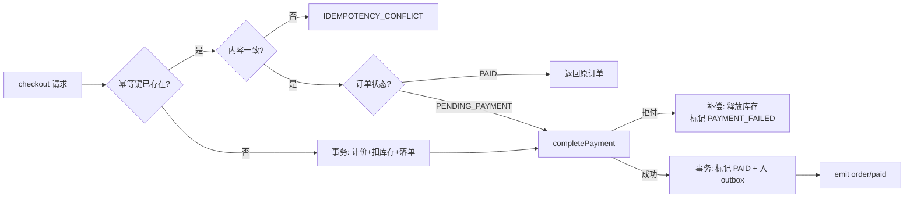
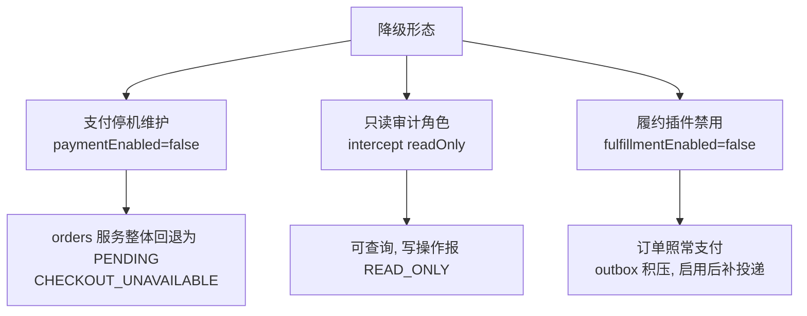
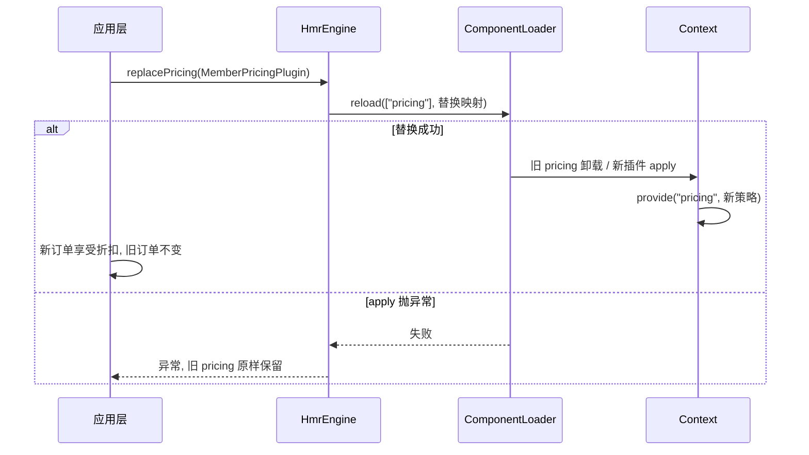

本文聚焦 cordis-example 电商工程中**可以被测试与运行时直接观察到的业务行为**：结账幂等、支付补偿、服务降级（停机维护 / 只读审计）以及促销插件的热替换。我们不解释框架内部机制本身（那是其他页面的职责），而是回答一个问题：当这些框架能力作用于一个真实业务编排时，外部世界看到什么？

## 结账编排：一条跨服务的业务流水线

`OrderService.checkout` 是整个示例的核心编排点，它把库存、定价、支付三个服务串成一条流水线：先按请求键查幂等历史，再在同一个数据库事务里完成"计价 → 扣库存 → 落单"，最后进入支付确认。值得注意的细节是 `order/paid` 事件在**释放业务锁之后**才发布，避免生命周期回退被业务锁阻塞。

Sources: [OrderService.java](cordis-example/src/main/java/dev/cordis/example/service/OrderService.java#L41-L73)

## 幂等：请求键是唯一事实来源

幂等语义由三层防护构成，每一层都有可观察的失败码：

| 场景 | 观察到的行为 | 失败码 / 结果 |
|---|---|---|
| 同键同内容重试 | 返回第一笔订单，不再扣库存、不再扣款 | 原订单 |
| 同键不同内容 | 直接拒绝 | `IDEMPOTENCY_CONFLICT` |
| 20 个虚拟线程并发同键结账 | 只产生一个订单 ID、一笔扣款、一次库存扣减 | 全部返回同一订单 |
| 支付提交后持久化失败重试 | 复用同一支付 ID，不重复收费、不改历史报价 | 订单可恢复 |

并发安全的实现方式是 `OrderService` 内部用 `synchronized(runtime)` 串行化结账操作，同时 `PaymentService.capture` 在数据库事务内做二次幂等检查——即使订单层锁失效，支付层也不会重复捕获：

Sources: [OrderService.java](cordis-example/src/main/java/dev/cordis/example/service/OrderService.java#L45-L60), [PaymentService.java](cordis-example/src/main/java/dev/cordis/example/service/PaymentService.java#L13-L27)

对应测试直接验证了这些外部观察点：`concurrentDuplicateRequestsDoNotOversellOrChargeTwice` 用 20 个并发请求断言同一订单 ID 与库存恰好减 2；`retriesAreIdempotentAndCannotReuseAKeyWithDifferentContent` 断言重试返回原单而改内容请求抛出冲突码。

Sources: [CommerceWorkflowTest.java](cordis-example/src/test/java/dev/cordis/example/CommerceWorkflowTest.java#L99-L130)

## 补偿：显式的业务回退，而非框架魔法

cordis 框架的 Disposable/LIFO 回退负责的是**运行时资源**（如把 `runtime.active` 置为 false），而业务数据的补偿是示例代码**显式编写**的，这是语义边界的关键区分（详见 [论文前提与语义边界：框架不保证的回退正确性](27-lun-wen-qian-ti-yu-yu-yi-bian-jie-kuang-jia-bu-bao-zheng-de-hui-tui-zheng-que-xing)）：

| 故障点 | 补偿动作 | 观察结果 |
|---|---|---|
| 库存不足 | 整车购物车随事务回滚，无订单记录残留 | 库存不变、`capturedCount == 0` |
| 支付被拒 | 事务内释放库存、订单标记 `PAYMENT_FAILED` 后重抛 | 保留失败历史供幂等键查询 |
| 已支付订单取消 | 退款 + 释放库存 + 移除 outbox 投递，均在单事务内 | 重复取消幂等返回 |
| 订单已出库 | 拒绝取消 | `ALREADY_FULFILLED`，走售后流程 |

`cancel` 的状态机尤其严格：只有 `PAID` 且未出库的订单才允许取消，取消是幂等的（重复 cancel 返回同一 `CANCELLED` 订单），出库后则强制走售后语义而不是盲目补货。

Sources: [OrderService.java](cordis-example/src/main/java/dev/cordis/example/service/OrderService.java#L52-L60), [OrderService.java](cordis-example/src/main/java/dev/cordis/example/service/OrderService.java#L78-L89)

补偿正确性的另一半来自**同事务性**：`InventoryService` 的 `reserve`/`release` 和订单状态变更共享同一个 `CommerceDatabase.Transaction`，因此"整车回滚"不需要额外代码——事务边界就是补偿边界。

Sources: [InventoryService.java](cordis-example/src/main/java/dev/cordis/example/service/InventoryService.java#L29-L41)

## 降级：三种可观察的服务退化形态

示例提供了三种不同粒度的降级，各自的观察信号不同：

**支付停机维护**是最激进的一种：`paymentEnabled(false)` 触发 ComponentLoader 调和，`orders` 插件的 fiber 回到 `PENDING` 状态，`app.orders()` 变为 null，旧的 `OrderService` 实例抛出 `CHECKOUT_UNAVAILABLE`——但业务历史完好，重新启用后查询与结账都恢复正常。这展示了框架"服务可用性回退、业务数据不回退"的设计：Disposable 只翻转 `runtime.active` 标志位。

Sources: [CommerceApplication.java](cordis-example/src/main/java/dev/cordis/example/CommerceApplication.java#L44-L52), [OrderService.java](cordis-example/src/main/java/dev/cordis/example/service/OrderService.java#L32-L34), [OrderService.java](cordis-example/src/main/java/dev/cordis/example/service/OrderService.java#L104-L106)

**只读审计**则完全不触碰生命周期：`context.intercept("orders", Map.of("readOnly", true))` 在调用者视图上注入配置，`writable()` 检查 `readOnly` 后拒绝写操作，读操作不受影响。

Sources: [CommerceApplication.java](cordis-example/src/main/java/dev/cordis/example/CommerceApplication.java#L45-L47), [OrderService.java](cordis-example/src/main/java/dev/cordis/example/service/OrderService.java#L107-L109)

**履约禁用**展示了 outbox 模式作为降级缓冲：禁用期间订单照常支付，投递事件在 `pendingDeliveries` 中积压；重新启用后 `dispatchPending` 在单事务内补建 shipment 并标记 delivered，重复启用不会产生重复发货。

Sources: [FulfillmentService.java](cordis-example/src/main/java/dev/cordis/example/service/FulfillmentService.java#L11-L23), [CommerceWorkflowTest.java](cordis-example/src/test/java/dev/cordis/example/CommerceWorkflowTest.java#L214-L224)

## 促销热替换：`replacePricing` 的两个保证

促销切换是本文的压轴行为：`CommerceApplication.replacePricing` 通过 `HmrEngine.reload` 把 `pricing` 插件替换为 `MemberPricingPlugin`（GOLD 会员在满足最低消费后享受基点折扣）。可观察到的两个核心保证是：

| 保证 | 验证方式 |
|---|---|
| **历史不可变** | 替换后旧订单查询返回原对象；改促销配置（10% → 15%）只影响新报价 |
| **失败回滚** | 发布抛异常的 `broken-pricing` 插件后，旧定价继续生效，注册表中查不到坏插件 |

注意 `MemberPricingPlugin` 继承 `StandardPricingPlugin` 并重写 `apply`，替换的本质是让新插件在激活时通过 `ctx.provide("pricing", ...)` 提供新的 `PricingPolicy` 函数——`OrderService` 每次结账时从上下文解析定价策略，因此切换对业务代码完全透明。

Sources: [CommerceApplication.java](cordis-example/src/main/java/dev/cordis/example/CommerceApplication.java#L54-L56), [MemberPricingPlugin.java](cordis-example/src/main/java/dev/cordis/example/plugins/MemberPricingPlugin.java#L12-L21), [StandardPricingPlugin.java](cordis-example/src/main/java/dev/cordis/example/plugins/StandardPricingPlugin.java#L20-L23)

测试 `pricingReleaseChangesOnlyNewQuotesAndBrokenReleaseRollsBack` 一次性验证了两个保证：热替换后新订单折扣 1360 分而旧订单原价；发布失败插件抛异常后，`root.registry().get(broken)` 为 null 且后续订单仍按旧策略计价。`promotionConfigurationIsAppliedWithoutRewritingHistory` 则验证配置级更新（折扣比例 10%→15%）同样只影响新订单。

Sources: [CommerceWorkflowTest.java](cordis-example/src/test/java/dev/cordis/example/CommerceWorkflowTest.java#L176-L213)

## 小结：行为矩阵

| 行为类别 | 关键机制 | 失败信号 | 历史数据 |
|---|---|---|---|
| 幂等 | 请求键 + 支付 ID 复用 | `IDEMPOTENCY_CONFLICT` | 重试返回原单 |
| 补偿 | 同事务回滚 + 显式释放库存 | `INSUFFICIENT_STOCK` / `PAYMENT_DECLINED` | 失败记录保留 |
| 降级 | 生命周期回退 / intercept 配置 / outbox 缓冲 | `CHECKOUT_UNAVAILABLE` / `READ_ONLY` | 完好，可恢复 |
| 促销热替换 | HmrEngine 事务性替换 + provide 切换 | 替换失败自动回滚 | 报价历史不可变 |

理解这些行为的实现边界后，建议继续阅读 [论文前提与语义边界：框架不保证的回退正确性](27-lun-wen-qian-ti-yu-yu-yi-bian-jie-kuang-jia-bu-bao-zheng-de-hui-tui-zheng-que-xing)，以及支撑热替换的 [HmrEngine 事务性替换：模块分类、失败回滚与陈旧条目检测](18-hmrengine-shi-wu-xing-ti-huan-mo-kuai-fen-lei-shi-bai-hui-gun-yu-chen-jiu-tiao-mu-jian-ce)；若想动手复现这些行为，可回到 [电商订单示例：运行与业务流程导览](4-dian-shang-ding-dan-shi-li-yun-xing-yu-ye-wu-liu-cheng-dao-lan)。