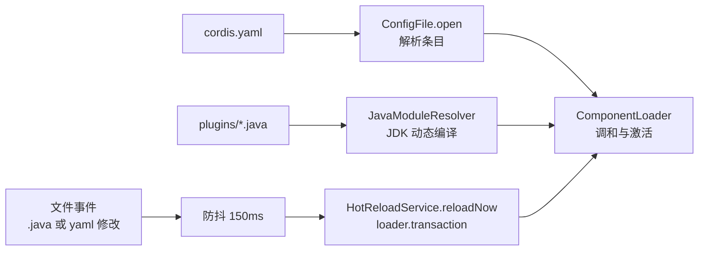

本文聚焦 cordis-java 提供的"开箱即用"热更新演示入口：`CordisApplication` 这个一体化应用启动器，以及 `examples/hot-reload` 目录中极简的可编辑插件示例。目标是用最少的文件让读者跑通"运行中修改 .java 源码 → 自动重新编译 → 旧实例卸载 → 新实例上线"的完整闭环。HMR 引擎内部的编译与替换原理不在本文展开，可参阅 [JavaModuleResolver：JDK 动态编译与逐代 ClassLoader 隔离](17-javamoduleresolver-jdk-dong-tai-bian-yi-yu-zhu-dai-classloader-ge-chi) 与 [HmrEngine 事务性替换：模块分类、失败回滚与陈旧条目检测](18-hmrengine-shi-wu-xing-ti-huan-mo-kuai-fen-lei-shi-bai-hui-gun-yu-chen-jiu-tiao-mu-jian-ce)。

## CordisApplication：组合四个服务的一体化入口

`CordisApplication` 位于 `cordis-core` 的 `dev.cordis.loader` 包中，它把配置加载、源码模块解析、配置监听与源码热更新四件事封装成一个实现了 `AutoCloseable` 的"被拥有的应用"。`open(Path config, Path sources, boolean watch)` 是唯一的工厂方法：它先创建根上下文，再构造 `JavaModuleResolver` 指向源码目录，随后用 `ConfigFile.open` 打开 YAML 配置生成 `ComponentLoader`；当 `watch` 为 true 时，还会挂上防抖 150 毫秒的 `ConfigWatcher`（监听配置文件）与 `HotReloadService`（监听 .java 源码）。注意构造过程中的资源回退：任何一步失败都会按 hmr → configs → loader → context fiber → modules 的顺序逐一关闭，这与框架"失败不阻断清理"的效应回退原则一致。

Sources: [CordisApplication.java](cordis-core/src/main/java/dev/cordis/loader/CordisApplication.java#L31-L60)

关闭路径同样有序：`close()` 被 `synchronized` 保护且幂等（`closed` 标志位），依次停止 HMR 服务、配置监听、关闭 loader、释放根上下文 fiber、最后关闭逐代 ClassLoader 的模块解析器。

Sources: [CordisApplication.java](cordis-core/src/main/java/dev/cordis/loader/CordisApplication.java#L62-L71)

## 命令行协议：--watch 与 --check

`main` 方法接受 2~3 个参数：`<config.yaml> <source-directory>` 加可选的 `--watch` 或 `--check`。两种模式行为截然不同：

| 参数 | 行为 | 适用场景 |
|---|---|---|
| 无第三参数 | 注册 JVM shutdown hook，在关闭钩子中调用 `app.close()` 后通过 `CountDownLatch` 阻塞主线程直到进程退出 | 长驻演示进程 |
| `--watch` | 相当于无第三参数，但额外启用了配置与源码监听 | 热更新演示 |
| `--check` | 打开应用后遍历 `loader.tree()`，用 `Stages.join(branch.awaitAllAsync())` 等待所有组件就绪即退出 | CI/部署前的启动健康检查 |

`--check` 模式把 `app` 放入 try-with-resources，意味着"验证能成功装配并激活"后立即干净关闭——这是把 Cordis 应用当作可校验产物使用的典型姿势。

Sources: [CordisApplication.java](cordis-core/src/main/java/dev/cordis/loader/CordisApplication.java#L73-L91)

## examples/hot-reload：最小可编辑示例

该目录只包含两个文件。`cordis.yaml` 声明了一个 id 为 `hello` 的条目，`url` 指向同目录下的 `HelloPlugin.java`，并附带 `config.message`：

```yaml
- id: hello
  url: HelloPlugin.java
  config:
    message: Hello from a live Java module
```

Sources: [cordis.yaml](examples/hot-reload/cordis.yaml#L1-L4)

`HelloPlugin` 是一个约 19 行的普通插件：从 config 中取出 `message`，通过 `ctx.provide("greeting", message)` 向上下文提供能力，并用 `ctx.logger("hello")` 打日志；其返回的 `Disposable` 在卸载时打印 "Previous greeting unloaded"。这个卸载日志正是观察热更新闭环的关键信号——旧实例被 drain 时会打印它，随后新实例打印新的 message。

Sources: [HelloPlugin.java](examples/hot-reload/plugins/HelloPlugin.java#L9-L19)

## 运行与观察热更新

README 给出的标准启动命令是通过 exec-maven-plugin 直接运行 `CordisApplication`：

```sh
mvn -pl cordis-core org.codehaus.mojo:exec-maven-plugin:3.2.0:java \
  -Dexec.mainClass=dev.cordis.loader.CordisApplication \
  -Dexec.args="examples/hot-reload/cordis.yaml examples/hot-reload/plugins --watch"
```

Sources: [README.md](README.md#L17-L20)

启动后的完整数据流如下：



运行中你可以做两类编辑来观察不同路径：

1. **编辑 `HelloPlugin.java`**（例如改 message 拼接逻辑）：`HotReloadService` 的虚拟线程监听整个源码目录树，收集到 `.java` 变更后防抖 150ms，随后在 `loader.transaction` 中"先编译导入、再 drain 全部旧实例、最后安装新实例"。
2. **编辑 `cordis.yaml`**（例如改 `config.message` 或新增条目）：由 `ConfigWatcher` 触发，走 ComponentLoader 的配置调和路径，而 `ConfigFile.open` 注册的 `onChange` 回调还会把条目变更原子回写到配置文件，形成双向同步。

Sources: [HotReloadService.java](cordis-core/src/main/java/dev/cordis/hmr/HotReloadService.java#L36-L79), [HotReloadService.java](cordis-core/src/main/java/dev/cordis/hmr/HotReloadService.java#L112-L119), [ConfigFile.java](cordis-core/src/main/java/dev/cordis/loader/ConfigFile.java#L135-L152)

## HotReloadService 与 ConfigWatcher 的监听细节

`HotReloadService` 用 `FileSystems.newWatchService()` 递归注册源码目录下所有子目录（含运行期间新建的目录），只对以 `.java` 结尾的文件累积变更；`OVERFLOW` 事件会保守地把整个源码根目录标记为 changed。防抖定时器触发时若变更集合命中 `externals`（外部不可热替换的模块），则发出 `hmr/restart-required` 事件而非尝试替换；普通替换失败则发出 `hmr/error` 事件并记录日志。监听器本身通过 `loader.context().effect(...)` 注册为上下文效应，关闭应用时随资源回退自动停止。

Sources: [HotReloadService.java](cordis-core/src/main/java/dev/cordis/hmr/HotReloadService.java#L36-L110)

两个守护组件的关键参数对比：

| 组件 | 监听对象 | 防抖 | 失败语义 |
|---|---|---|---|
| `HotReloadService` | 源码目录树中的 `.java` | 150ms（构造传入） | 发 `hmr/error` 事件，事务回滚 |
| `ConfigWatcher` | 配置文件本身 | 150ms | 错误时保留原配置树 |

Sources: [CordisApplication.java](cordis-core/src/main/java/dev/cordis/loader/CordisApplication.java#L48-L50), [HotReloadService.java](cordis-core/src/main/java/dev/cordis/hmr/HotReloadService.java#L94-L110)

## 阅读路线建议

跑通本演示后，建议按依赖方向深入：先读 [JavaModuleResolver：JDK 动态编译与逐代 ClassLoader 隔离](17-javamoduleresolver-jdk-dong-tai-bian-yi-yu-zhu-dai-classloader-ge-chi) 理解"每代一个 ClassLoader"的隔离基础，再读 [HmrEngine 事务性替换：模块分类、失败回滚与陈旧条目检测](18-hmrengine-shi-wu-xing-ti-huan-mo-kuai-fen-lei-shi-bai-hui-gun-yu-chen-jiu-tiao-mu-jian-ce) 理解替换的事务性；为什么编辑一个文件会重载整个源码目录，见 [保守引用分析：为什么热更新会重载整个源码目录](19-bao-shou-yin-yong-fen-xi-wei-shi-yao-re-geng-xin-hui-zhong-zai-zheng-ge-yuan-ma-mu-lu)；哪些场景无法热替换则见 [适配边界：externals、restart-required 与不支持的场景](20-gua-pei-bian-jie-externals-restart-required-yu-bu-zhi-chi-de-chang-jing)。若想看更贴近真实业务的热替换（促销策略），可转向 [可观察的业务行为：幂等、补偿、降级与促销热替换](24-ke-guan-cha-de-ye-wu-xing-wei-mi-deng-bu-chang-jiang-ji-yu-cu-xiao-re-ti-huan)。