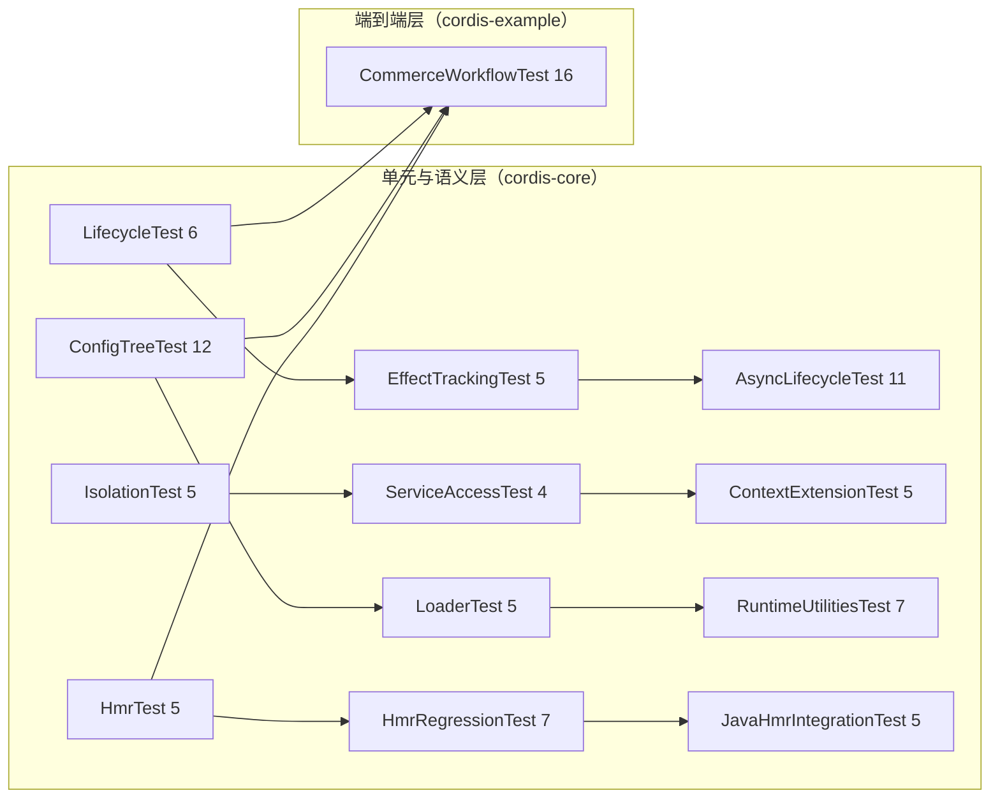

cordis-java 的测试体系由 13 个 JUnit 5 测试类组成，共计 93 个 `@Test` 用例：12 个位于 [cordis-core/src/test/java/dev/cordis](cordis-core/src/test/java/dev/cordis) 覆盖运行时核心，1 个位于 [cordis-example/src/test/java/dev/cordis/example/CommerceWorkflowTest.java](cordis-example/src/test/java/dev/cordis/example/CommerceWorkflowTest.java#L55) 以真实电商业务为载体做端到端验证。构建侧仅依赖 Maven Surefire 插件（3.2.5），没有额外的测试基建，所有断言都基于 JUnit 原生 API。

Sources: [pom.xml](pom.xml#L48-L50)，[CommerceWorkflowTest.java](cordis-example/src/test/java/dev/cordis/example/CommerceWorkflowTest.java#L29)

## 测试版图：测试类与被测能力的映射

测试类的划分与框架的架构分层一一对应——每个测试类几乎都能在 wiki 目录中找到对应的"深入解析"章节。这意味着测试不仅验证正确性，本身就是各语义边界的可执行规范：

| 测试类 | 用例数 | 验证的核心语义 | 对应 wiki 章节 |
|---|---|---|---|
| [LifecycleTest](cordis-core/src/test/java/dev/cordis/LifecycleTest.java#L59-L136) | 6 | provide 激活/撤下/替换、同 realm 重复提供抛错、restart 与 update | 六态生命周期模型 |
| [AsyncLifecycleTest](cordis-core/src/test/java/dev/cordis/AsyncLifecycleTest.java#L16-L209) | 11 | 异步 setup/teardown、失败恢复、逆操作全部执行、并行事件 | 异步效应 |
| [EffectTrackingTest](cordis-core/src/test/java/dev/cordis/EffectTrackingTest.java#L39-L98) | 5 | LIFO 逆操作顺序、explicitDispose 幂等、已卸载 fiber 上挂效应抛错 | 效应与资源回退 |
| [IsolationTest](cordis-core/src/test/java/dev/cordis/IsolationTest.java#L38-L98) | 5 | 同名服务跨域独立、通知不跨 realm、拦截子域优先 | isolate 与 RealmKey |
| [ServiceAccessTest](cordis-core/src/test/java/dev/cordis/ServiceAccessTest.java#L35-L95) | 4 | 未声明不可访问、未加载抛 inactive、根上下文非严格 | 响应式依赖 / 调用者视图 |
| [ContextExtensionTest](cordis-core/src/test/java/dev/cordis/ContextExtensionTest.java#L16-L78) | 5 | 注入元数据决定可用性、mixin 经调用者上下文解析、once/log 是 owned effect | accessor/mixin/call |
| [ConfigTreeTest](cordis-core/src/test/java/dev/cordis/ConfigTreeTest.java#L32-L197) | 12 | 组嵌套差分调和、YAML/JSON 往返、include 级联、重复 id 拒绝、并发调和按序 | ComponentLoader / 配置树 |
| [LoaderTest](cordis-core/src/test/java/dev/cordis/LoaderTest.java#L50-L165) | 5 | 增删改调和、disabled 挂起、url 变更重建、schema 失败置 FAILED | ComponentLoader 调和机制 |
| [RuntimeUtilitiesTest](cordis-core/src/test/java/dev/cordis/RuntimeUtilitiesTest.java#L28-L145) | 7 | 上下文接口热更新、并发装载、debounce/throttle、文件监听调和 | 日志与 TimerService / ConfigWatcher |
| [HmrTest](cordis-core/src/test/java/dev/cordis/HmrTest.java#L25-L85) | 5 | 模块分类、externals 永不接受、陈旧检测、事务回滚 | HmrEngine 事务性替换 |
| [HmrRegressionTest](cordis-core/src/test/java/dev/cordis/HmrRegressionTest.java#L15-L109) | 7 | 深依赖发现不污染迭代器、启动失败不残留运行时、回滚先清理后恢复 | HMR 回归保护 |
| [JavaHmrIntegrationTest](cordis-core/src/test/java/dev/cordis/JavaHmrIntegrationTest.java#L34-L120) | 5 | 真实 JDK 编译重载、语法/启动失败恢复旧代码、WatchService、共享 helper 触发全量重载 | JavaModuleResolver 集成 |
| [CommerceWorkflowTest](cordis-example/src/test/java/dev/cordis/example/CommerceWorkflowTest.java#L54-L242) | 16 | 幂等、补偿、降级、租户隔离、持久化、重启恢复 | 电商示例 |

Sources: [LifecycleTest.java](cordis-core/src/test/java/dev/cordis/LifecycleTest.java#L59-L136)，[HmrRegressionTest.java](cordis-core/src/test/java/dev/cordis/HmrRegressionTest.java#L15-L109)

## 测试风格：内联匿名插件 + TempDir + 类级超时

core 测试没有引入 mock 框架，而是直接用框架自身的 `Plugin` 接口构造极小的"提供者/消费者"插件，通过 `List<String> log` 记录生命周期事件顺序来断言语义。例如 [LifecycleTest](cordis-core/src/test/java/dev/cordis/LifecycleTest.java#L15-L33) 的 `provider(value, log)` 在 apply 中 `ctx.provide("svc", value)` 并记录 `provider-up`，在 Disposable 中记录 `provider-down`——用 20 行代码即可验证"撤下→再提供→再激活"的完整故事线。

所有涉及文件系统的测试类都使用 JUnit 的 `@TempDir` 注入临时目录，并在类级别施加 `@Timeout` 防御性超时（core 多数为 10 秒，涉及真实编译的 [JavaHmrIntegrationTest](cordis-core/src/test/java/dev/cordis/JavaHmrIntegrationTest.java#L29) 为 20 秒），防止异步语义错误导致的测试挂起。

Sources: [LifecycleTest.java](cordis-core/src/test/java/dev/cordis/LifecycleTest.java#L15-L33)，[JavaHmrIntegrationTest.java](cordis-core/src/test/java/dev/cordis/JavaHmrIntegrationTest.java#L29)

## 关键语义边界的验证方式

### 响应式生命周期与异步效应

[LifecycleTest.consumerWaitsThenActivatesOnProvide](cordis-core/src/test/java/dev/cordis/LifecycleTest.java#L60) 验证消费者在依赖缺失时等待、提供后自动激活；[withdrawingProviderDeactivatesThenReprovideReactivates](cordis-core/src/test/java/dev/cordis/LifecycleTest.java#L73) 验证撤下触发卸载、恢复后重挂。[duplicateProvideInSameRealmThrows](cordis-core/src/test/java/dev/cordis/LifecycleTest.java#L105) 守住"同一 realm 不能重复提供"的硬约束。

异步侧更微妙：[AsyncLifecycleTest](cordis-core/src/test/java/dev/cordis/AsyncLifecycleTest.java#L62) 中 `partiallyYieldedStartupIsRecoveredOnFailure` 验证启动中途让出后失败仍能回收已产生的效应；[allInversesRunEvenWhenOneThrows](cordis-core/src/test/java/dev/cordis/AsyncLifecycleTest.java#L171) 验证一个逆操作抛异常不会阻断其余清理——这与"失败不阻断清理"的回退协议完全一致。

Sources: [LifecycleTest.java](cordis-core/src/test/java/dev/cordis/LifecycleTest.java#L60-L136)，[AsyncLifecycleTest.java](cordis-core/src/test/java/dev/cordis/AsyncLifecycleTest.java#L62-L209)

### 配置调和的失败安全性

[ConfigTreeTest](cordis-core/src/test/java/dev/cordis/ConfigTreeTest.java#L32-L197) 的断言粒度直达 fiber 身份：`nestedGroupReconcilesWithoutRestartingUnchangedChildren` 用 `AtomicInteger` 计数插件装载次数，断言未变更子项的 **Fiber 实例（assertSame）不被替换**。失败路径同样被系统验证——[duplicateIdsAreRejectedBeforeRemovingExistingEntries](cordis-core/src/test/java/dev/cordis/ConfigTreeTest.java#L82) 确认重复 id 在删除旧条目**之前**被拒绝（即失败不破坏现状），[conflictingRealmMoveRollsBackScopeAndBinding](cordis-core/src/test/java/dev/cordis/ConfigTreeTest.java#L183) 验证冲突的 realm 迁移会回滚作用域与绑定，[concurrentReconciliationsApplyInSubmissionOrder](cordis-core/src/test/java/dev/cordis/ConfigTreeTest.java#L196) 验证并发调和按提交顺序生效。

Sources: [ConfigTreeTest.java](cordis-core/src/test/java/dev/cordis/ConfigTreeTest.java#L32-L197)

### HMR：从单元回归到真实编译集成

HMR 测试分三层递进。[HmrTest](cordis-core/src/test/java/dev/cordis/HmrTest.java#L25-L85) 直接测试 `HmrEngine.classify` 的纯函数语义，用 lambda 构造 `ModuleGraph`，例如 `classificationDiscoversDeepDependenciesWithoutMutatingIterator`（[HmrRegressionTest.java](cordis-core/src/test/java/dev/cordis/HmrRegressionTest.java#L15-L28)）用 "S→x→y→q" 的深链验证传染性降级且不修改迭代器。[JavaHmrIntegrationTest](cordis-core/src/test/java/dev/cordis/JavaHmrIntegrationTest.java#L34-L120) 则走全链路：写真实 `.java` 源文件 → JDK 动态编译 → `HotReloadService.reloadNow()` → 断言新值生效且 ClassLoader 代际更替（`assertNotSame(old, ...)`），并覆盖语法错误、启动失败后恢复旧代码与缓存的场景。

Sources: [HmrTest.java](cordis-core/src/test/java/dev/cordis/HmrTest.java#L25-L85)，[HmrRegressionTest.java](cordis-core/src/test/java/dev/cordis/HmrRegressionTest.java#L15-L28)，[JavaHmrIntegrationTest.java](cordis-core/src/test/java/dev/cordis/JavaHmrIntegrationTest.java#L34-L120)

## 端到端层：CommerceWorkflowTest 作为可执行的业务规范

[CommerceWorkflowTest](cordis-example/src/test/java/dev/cordis/example/CommerceWorkflowTest.java#L29-L54) 的 16 个用例不是对 core API 的测试，而是对"框架语义如何落地为业务保障"的验证。`@BeforeEach` 创建 `Context.createRoot()` 并用 `CommerceApplication` 组装插件，`@AfterEach` 显式 dispose 根 fiber——测试本身就在演练完整的生命周期协议。

用例覆盖了此前各章讨论过的所有行为维度：

- **幂等与并发**：[retriesAreIdempotentAndCannotReuseAKeyWithDifferentContent](cordis-example/src/test/java/dev/cordis/example/CommerceWorkflowTest.java#L87) 验证重试幂等及同 key 不同内容的拒绝；[concurrentDuplicateRequestsDoNotOversellOrChargeTwice](cordis-example/src/test/java/dev/cordis/example/CommerceWorkflowTest.java#L99) 用并发线程验证不超卖、不重复扣款。
- **补偿与回退**：[insufficientStockRollsBackTheEntireCart](cordis-example/src/test/java/dev/cordis/example/CommerceWorkflowTest.java#L77)、[cancellationRefundsAndReleasesStockOnceBeforeWarehouseDispatch](cordis-example/src/test/java/dev/cordis/example/CommerceWorkflowTest.java#L183) 验证补偿恰好执行一次且顺序正确。
- **降级与热替换**：[paymentMaintenanceDeactivatesCheckoutAndPreservesBusinessData](cordis-example/src/test/java/dev/cordis/example/CommerceWorkflowTest.java#L124) 验证停机维护仅停用 checkout 而保留数据；[promotionConfigurationIsAppliedWithoutRewritingHistory](cordis-example/src/test/java/dev/cordis/example/CommerceWorkflowTest.java#L159) 验证促销配置热更新不改写历史订单。
- **租户隔离与持久化**：[tenantsHaveSeparateCatalogsInventoryPaymentsOrdersAndEvents](cordis-example/src/test/java/dev/cordis/example/CommerceWorkflowTest.java#L216) 验证双租户完全隔离；[ordersAndReceiptsSurviveClosingEveryPluginAndReopeningDisk](cordis-example/src/test/java/dev/cordis/example/CommerceWorkflowTest.java#L204) 验证关闭全部插件后重开磁盘数据完好；[databaseFileLockPreventsTwoSessionsFromOverwritingTheSameTenant](cordis-example/src/test/java/dev/cordis/example/CommerceWorkflowTest.java#L234) 验证文件锁防并发覆盖。
- **崩溃恢复**：最后一个用例 [restartRecoversAPaymentCapturedBeforeThePaidOrderCommit](cordis-example/src/test/java/dev/cordis/example/CommerceWorkflowTest.java#L242) 验证"已扣款但订单未提交"的中间态在重启后可恢复——这是对回退正确性边界的直接检验。

Sources: [CommerceWorkflowTest.java](cordis-example/src/test/java/dev/cordis/example/CommerceWorkflowTest.java#L54-L242)

## 覆盖缺口与阅读延伸

从测试版图可以看出明显的重心：生命周期/效应（22 例）与 HMR（17 例）合计占 core 测试的三分之二，反映这两个子系统的状态机最复杂、回归风险最高。相对薄弱的是事件系统（仅在 [AsyncLifecycleTest.parallelEventWaitsForAllListeners](cordis-core/src/test/java/dev/cordis/AsyncLifecycleTest.java#L196) 单点覆盖 waterfall/serial 等组合）与 ServiceAccess 规则（4 例），这些语义更多依赖端到端层的间接覆盖。

建议按以下路径继续阅读：想理解被测语义本身，从 [六态生命周期模型：PENDING 到 DISPOSED 的转换与 await 语义](5-liu-tai-sheng-ming-zhou-qi-mo-xing-pending-dao-disposed-de-zhuan-huan-yu-await-yu-yi) 入手；想了解端到端测试所依附的业务架构，参见 [电商示例架构：插件职责、服务组装与本地沙箱适配器](23-dian-shang-shi-li-jia-gou-cha-jin-zhi-ze-fu-wu-zu-zhuang-yu-ben-di-sha-xiang-gua-pei-qi)；崩溃恢复用例背后的理论边界则在 [论文前提与语义边界：框架不保证的回退正确性](27-lun-wen-qian-ti-yu-yu-yi-bian-jie-kuang-jia-bu-bao-zheng-de-hui-tui-zheng-que-xing) 中展开。