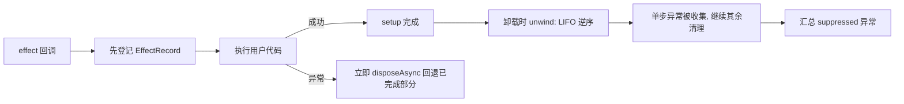
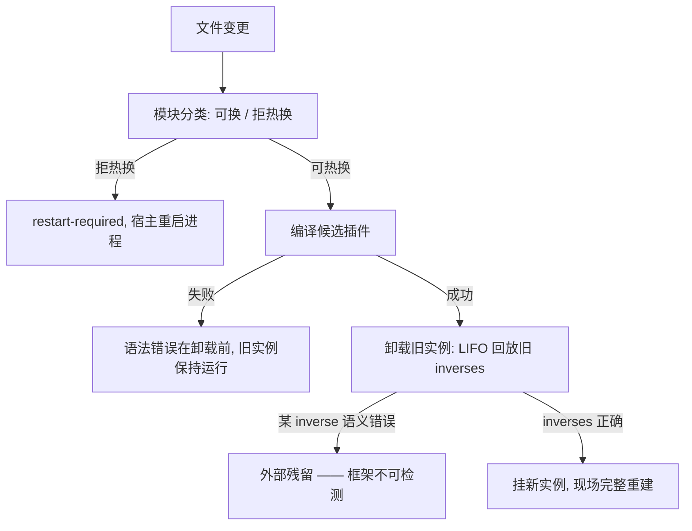

cordis-java 的回退机制源自论文 *A Programming Paradigm for Spatiotemporal Composability* 的第 3–5 章。这篇文档回答一个关键问题：**框架承诺了什么，以及哪些正确性必须由插件作者自己承担**。核心结论是：框架保证的是“回退的执行协议”（登记、逆序、失败不阻断），而不是“回退的结果正确”——后者是一个语义前提，无法由任何运行时机械地证明。

## 论文正确性结论的三条前提

README 在“验证与语义边界”一节明确指出：论文的正确性结论具有前提——插件作者提供的逆操作必须实际撤销效应，服务操作须遵守对应的可组合性约束。框架不会自动撤销任意文件、网络请求或数据库写入，也不能证明用户提供的 inverse 正确；本项目提供机制及其行为验证，但**不将单元测试等同于对整个 Java 实现的形式化证明**。这三条前提分别对应：逆操作的语义正确性（作者责任）、服务可组合性（架构责任）、以及测试的证明力上限（验证边界）。

Sources: [README.md](README.md#L175-L183)

## 框架保证的部分：回退的执行协议

框架真正机械保证的是一套执行协议，而不是语义。第一，**登记协议**：`Context.effect(cb)` 在执行用户代码前就把效应记录登记到所有者 fiber（`records.add(record)` 先于 `callback.execute(ctx)`），避免重入卸载时遗漏资源。第二，**失败即回退**：效应回调抛出异常时立即触发 `record.disposeAsync()`，只回滚已完成的部分。第三，**LIFO 逆序与失败不阻断**：`unwind` 从列表尾部反向遍历逆操作，每一步的异常被收集而非中断循环，最终以第一个异常为主、其余为 suppressed 汇总抛出——即“单项失败不阻止其余清理”。

注意这些保证都是**结构性的**：它们确保逆操作“会被调用、按正确顺序调用、失败也尽量全部调用”，但对逆操作体本身做了什么不置一词——一个空实现的 `Disposable` 同样满足协议。

Sources: [Fiber.java](cordis-core/src/main/java/dev/cordis/core/runtime/Fiber.java#L153-L185), [Fiber.java](cordis-core/src/main/java/dev/cordis/core/runtime/Fiber.java#L233-L249), [Disposable.java](cordis-core/src/main/java/dev/cordis/core/effect/Disposable.java#L3-L14)

## 框架不保证的部分：对照表

下表把论文前提落到了 JVM 实现的每一类具体边界上：

| 维度 | 框架保证 | 框架不保证（作者/宿主责任） |
|---|---|---|
| 回退执行 | 先登记后执行、LIFO 逆序、失败不阻断 | inverse 是否真的撤销了效应 |
| 异步阶段 | 已开始的阶段会完成，其逆操作始终保留后再停止 | 阶段外部副作用（如已发出的网络请求）可被撤销 |
| 外部世界 | 提供登记机制与生命周期钩子 | 任意文件写入、数据库事务、外部系统状态 |
| 服务拦截 | 视图共享底层状态、调用时解析策略 | `readOnly` 等元数据被自动解释成权限 |
| HMR | 事务性替换：候选失败先清理候选、恢复旧插件 | 运行中对象的字段迁移、外部数据库事务回滚 |
| 验证 | 93 个测试用例的行为验证 | 对整个实现的形式化证明 |

异步效应的边界尤其值得强调：`collectAsync` 中每个已完成的 step 的 inverse 都会被加入 sink，即使迭代随后停止——这保证“已完成部分可回滚”，但如果一个阶段的副作用发生在 inverse 返回之前（例如消息已发出），框架无从追溯。

Sources: [README.md](README.md#L51-L57), [Fiber.java](cordis-core/src/main/java/dev/cordis/core/runtime/Fiber.java#L218-L231), [README.md](README.md#L157-L160)

## 为什么 HMR 的“自动回滚重放”不违背这个前提

HMR 的文档声称“换模块 = 卸旧运行实例 + 挂新运行实例，效应自动回滚重放”，看似绕过了“逆操作正确性”前提，实则没有：它依赖的正是每个 fiber 圈住了组件全部效应这一结构性质。回滚重放的正确性仍然建立在**旧插件登记的每个 inverse 都真的撤销了自己的效应**之上——如果某个插件的 inverse 是空操作，HMR 卸载旧实例后该效应的外部残留依然存在。HMR 只是让“正确编写的插件”获得了免手写 accept 边界的红利；它同时采取保守策略应对不可判定性：循环引用一律按“拒热换”处理，因为引用关系定不下来。

Sources: [HmrEngine.java](cordis-core/src/main/java/dev/cordis/hmr/HmrEngine.java#L14-L27), [HmrEngine.java](cordis-core/src/main/java/dev/cordis/hmr/HmrEngine.java#L48-L54), [README.md](README.md#L152-L155)

## 服务可组合性约束：拦截元数据的解释权

论文前提的第二条落在 coeffect 层。`ReflectService` 按 `RealmKey` 隔离域存放绑定，绑定变化广播给声明该服务的 fiber，实现“依赖齐了自动启动，缺了自动卸载”的响应式语义。但 `isolate/intercept` 配置中的任意元数据（如 `readOnly: true`）**不会被框架自动解释成权限**——其解释由服务实现通过 `ContextualService<T>` 调用者视图完成。这意味着“多租户读写隔离”这类可组合性约束的正确性由服务作者承担，框架只保证视图共享底层状态并在方法调用时解析当前上下文的策略。同样，`ctx.set` 只允许提供者更新自己的值，这一能力检查也是协议性的，不阻止提供者写入语义上错误的值。

Sources: [README.md](README.md#L67-L73), [coeffect/package-info.java](cordis-core/src/main/java/dev/cordis/core/coeffect/package-info.java#L1-L12)

## 验证的真实边界：行为测试 ≠ 形式化证明

测试体系的覆盖面包括异步生命周期、回退异常、根关闭、消费者策略、域迁移、配置树/回写、真实文件监听、JDK 动态编译、共享辅助类变更和多插件 HMR 失败恢复，源码及文件监听集成测试使用临时目录和真实 JDK 编译器。这些测试验证的是**机制的实现行为**（协议是否被遵守），而非论文结论在所有程序上的成立性。这是工程实现与形式化方法之间的诚实边界：`EffectTrackingTest`、`LifecycleTest` 等可以证明“逆序被调用、异常被收集”，但无法证明“每个用户插件提供的 inverse 都满足 inverse(op) ∘ op = id”这一数学性质——后者本质上要求对任意用户代码的语义推理。

| 验证层次 | 能证明 | 不能证明 |
|---|---|---|
| 协议测试 | 登记时序、LIFO、失败汇总 | inverse 的语义正确性 |
| 集成测试 | 编译→替换→回滚的端到端行为 | 所有源码形态下的 HMR 正确性 |
| 论文层面 | 算法在满足前提时的正确性 | 前提本身对任意用户代码成立 |

Sources: [README.md](README.md#L177-L183)

## 对插件作者的实践启示

基于以上边界，编写 cordis 插件时应把 inverse 视为**契约**而非可选项：打开连接配套关闭、注册监听配套注销、写入临时状态配套清除。异步效应中，尽量让每个阶段的副作用发生在 inverse 已可覆盖的范围内，避免“阶段开始即不可撤销”的外部调用。服务作者应在 `ContextualService` 视图中显式解释 `intercept` 元数据，而不是假设框架兜底。使用 HMR 时理解其保守策略：externals 文件变化只会发出 `hmr/restart-required`，进程级重启由宿主决定；需要额外依赖时显式传 classpath，而不是期待动态下载。

Sources: [README.md](README.md#L50-L57), [README.md](README.md#L156-L160)

## 延伸阅读

理解“框架保证什么”之后，建议按以下顺序深入：先看回退协议的完整实现细节 [效应与资源回退：Disposable、LIFO 逆操作与失败不阻断清理](6-xiao-ying-yu-zi-yuan-hui-tui-disposable-lifo-ni-cao-zuo-yu-shi-bai-bu-zu-duan-qing-li) 和异步边界 [异步效应：CompletionStage、AsyncEffect.next 与 AsyncDisposable](7-yi-bu-xiao-ying-completionstage-asynceffect-next-yu-asyncdisposable)；再看 HMR 如何在回退协议之上实现事务性替换 [HmrEngine 事务性替换：模块分类、失败回滚与陈旧条目检测](18-hmrengine-shi-wu-xing-ti-huan-mo-kuai-fen-lei-shi-bai-hui-gun-yu-chen-ji-tiao-mu-jian-ce) 与适配边界 [适配边界：externals、restart-required 与不支持的场景](20-gua-pei-bian-jie-externals-restart-required-yu-bu-zhi-chi-de-chang-jing)；最后通过 [测试体系：93 个测试用例覆盖的行为与语义边界](26-ce-shi-ti-xi-93-ge-ce-shi-yong-li-fu-gai-de-xing-wei-yu-yu-yi-bian-jie) 查看行为验证的具体清单。