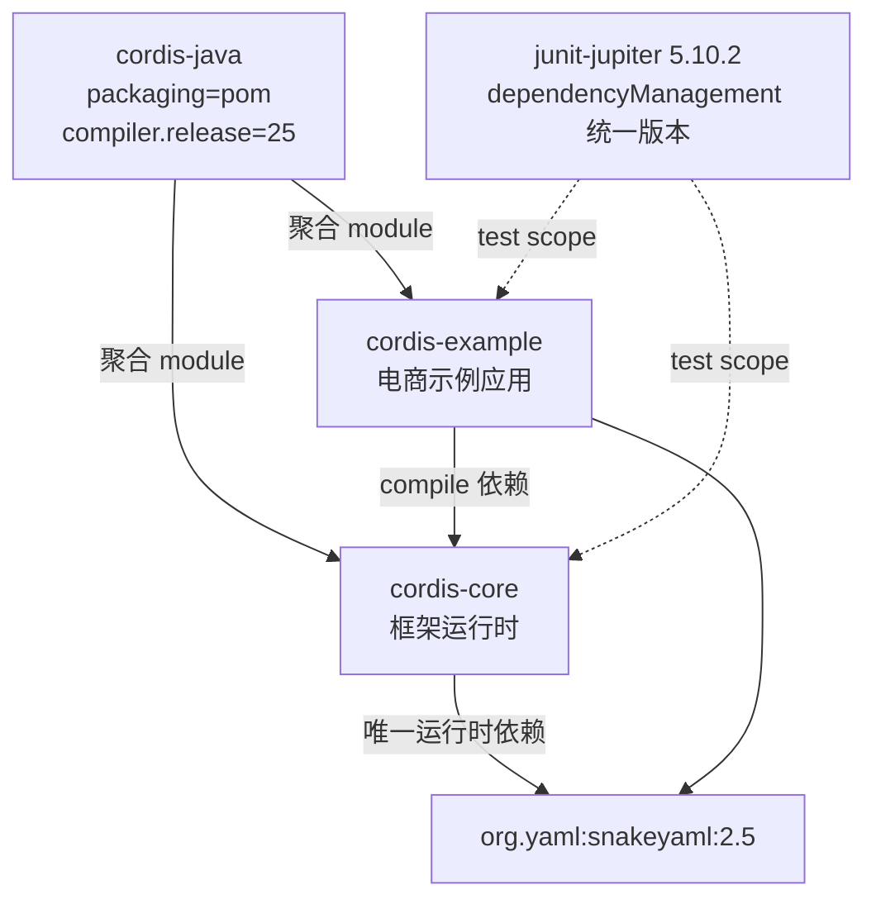

cordis-java 采用极简的多模块 Maven 结构：一个聚合父 POM 管理两个子模块 `cordis-core` 与 `cordis-example`，全仓库唯一的第三方运行时依赖是 SnakeYAML（2.5）。本文解析这一结构的组成、依赖传递关系、版本与编译基线的集中管理方式，以及“仅 SnakeYAML”这一依赖策略背后的取舍。本文属于工程实践视角的静态结构分析，不涉及运行时生命周期语义（见 [项目概览：cordis-java 是什么](1-xiang-mu-gai-lan-cordis-java-shi-shi-yao)）。

## 整体结构：父 POM 与两个子模块

仓库根目录的 `pom.xml` 是 `packaging=pom` 的聚合 POM，通过 `<modules>` 声明 `cordis-core` 与 `cordis-example` 两个子模块。父 POM 本身不含任何直接依赖，只承担三件事：统一编译基线（`maven.compiler.release=25`）、集中版本属性（JUnit 5.10.2 通过 `${junit.version}` 引用）、以及通过 `dependencyManagement` 与 `pluginManagement` 锁定 JUnit 和 maven-compiler-plugin（3.14.1）/ maven-surefire-plugin（3.2.5）的版本。子模块通过 `<parent>` 反向引用父 POM（`dev.cordis:cordis-java:1.0.0`），形成标准的“父管配置、子管依赖”分层。

Sources: [pom.xml](pom.xml#L1-L50)

## cordis-core：框架模块的最小依赖面

`cordis-core` 的依赖列表只有两项：`org.yaml:snakeyaml:2.5`（compile scope，会传递给下游）与 `junit-jupiter`（test scope，版本由父 POM 的 `dependencyManagement` 提供）。SnakeYAML 在 core 中仅服务于配置 I/O 一个职责：[ConfigFile.java](cordis-core/src/main/java/dev/cordis/loader/ConfigFile.java#L1-L21) 使用 `new Yaml(new SafeConstructor(options)).load(reader)` 解析 YAML/JSON 配置（并禁用重复 key），回写时用 `DumperOptions` 按文件扩展名切换 BLOCK/FLOW 风格。框架其余部分——生命周期、效应系统、HMR、事件等——完全不依赖第三方库。

值得注意的是，JSON 序列化是手写的：由于 YAML flow style 不保证 JSON 引号语义，`ConfigFile.json` 以纯 Java 递归实现了字符串转义与数字校验，而不是引入 Jackson 之类的 JSON 库（[ConfigFile.java](cordis-core/src/main/java/dev/cordis/loader/ConfigFile.java#L63-L112)）。这正是“仅 SnakeYAML”策略在代码层面的直接体现。

## cordis-example：显式声明传递依赖

`cordis-example` 依赖 `dev.cordis:cordis-core:1.0.0`，并同时声明了自己的 SnakeYAML 2.5——用于电商示例的本地持久化：[CommerceDatabase.java](cordis-example/src/main/java/dev/cordis/example/persistence/CommerceDatabase.java#L4-L5) 同样以 `SafeConstructor` 读取、`Yaml` 回写店铺快照（`shop-a.yaml` / `shop-b.yaml`）。虽然 SnakeYAML 理论上可经 cordis-core 传递获得，示例模块仍显式声明，这是“不依赖上游实现细节”的防御性写法。

此外，示例模块通过 `exec-maven-plugin` 配置了 `dev.cordis.example.Main` 入口，支持 `mvn -pl cordis-example exec:java` 一键运行（[cordis-example/pom.xml](cordis-example/pom.xml#L1-L41)，运行方式见 [cordis-example/README.md](cordis-example/README.md#L5-L13)）。

## 依赖策略对比

| 维度 | cordis-core | cordis-example |
|---|---|---|
| 内部依赖 | 无 | cordis-core 1.0.0 |
| 运行时第三方依赖 | snakeyaml 2.5（compile） | snakeyaml 2.5（显式声明，非传递） |
| 测试依赖 | junit-jupiter（版本由父 POM 管理） | junit-jupiter（test） |
| 额外插件 | 无（compiler/surefire 来自 pluginManagement） | exec-maven-plugin 3.2.0（mainClass 配置） |

SnakeYAML 2.5 的选择也有安全考量：解析路径统一走 `SafeConstructor`，避免任意对象反序列化标签；`LoaderOptions.setAllowDuplicateKeys(false)` 则把重复 key 从静默覆盖变为显式报错。

## 构建环境约定

JDK 25 基线通过两处固化：父 POM 的 `<maven.compiler.release>25</maven.compiler.release>` 保证编译目标一致，仓库根的 [mise.toml](mise.toml#L1-L2) 声明 `java = "25"` 供本地工具链管理。环境搭建与构建命令的完整说明见 [环境准备与构建运行（JDK 25 / Maven）](2-huan-jing-zhun-bei-yu-gou-jian-yun-xing-jdk-25-maven)。

## 小结

cordis-java 的 Maven 策略可以概括为“三层收敛”：父 POM 收敛工具链与版本、`dependencyManagement` 收敛测试依赖、依赖面收敛到唯一运行时库 SnakeYAML。JSON 支持以手写序列化代替引入第二个 JSON 库，代价被控制在约 50 行代码内。这种最小依赖面显著降低了框架的传递风险与审计成本，也与仓库根目录中作为配置样例存在的 [examples/hot-reload/cordis.yaml](examples/hot-reload/cordis.yaml) 所描述的纯 YAML 配置体系互相呼应（配置语义详见 [YAML/JSON 配置格式：group、include 与循环引用检测](14-yaml-json-pei-zhi-ge-shi-group-include-yu-xun-huan-yin-yong-jian-ce)）。