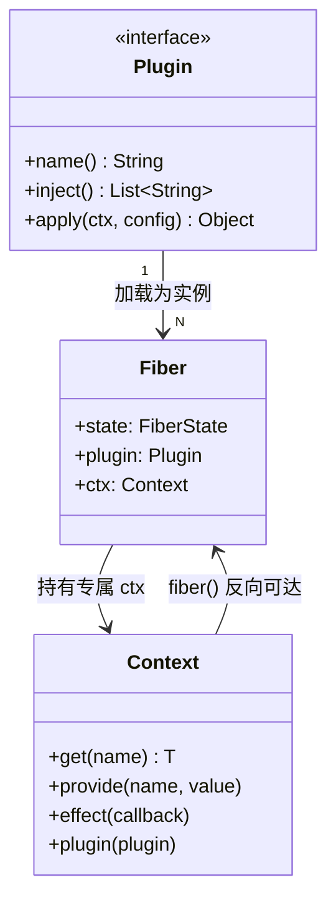
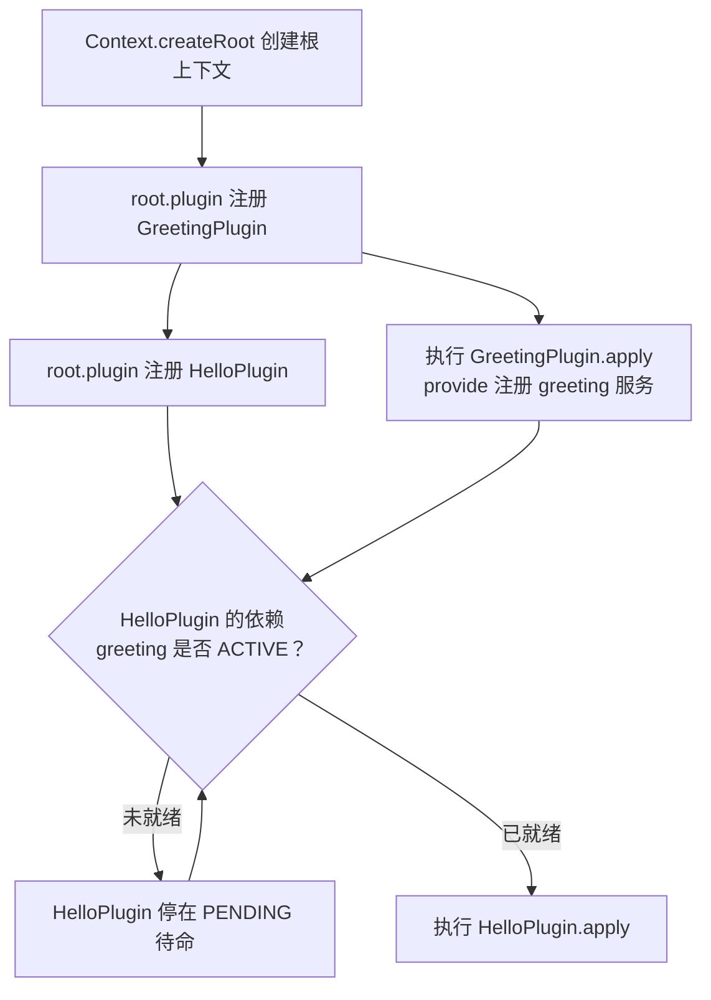
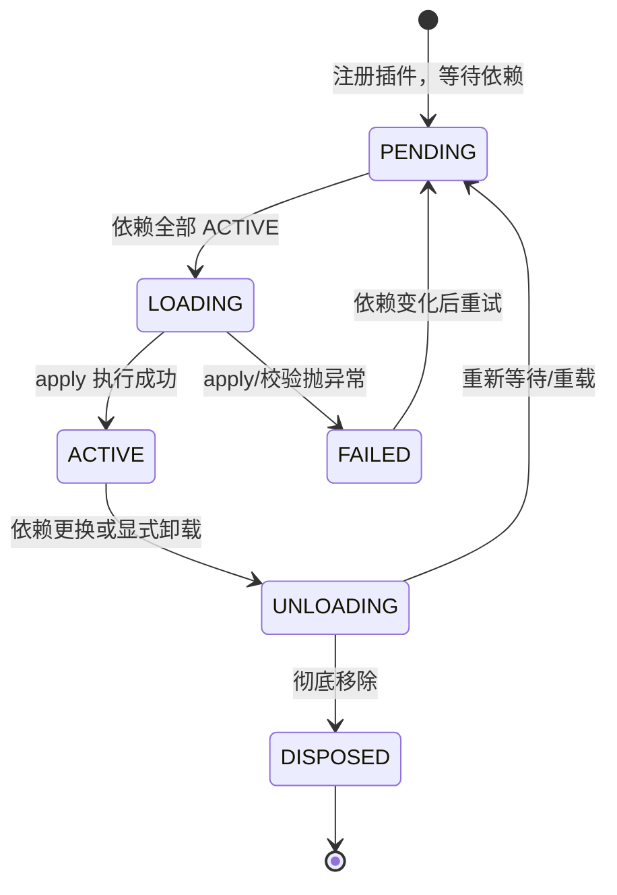

本文是快速开始的第三站。读完前两篇后，你已经能构建并运行 cordis-java；现在我们要亲手写出第一个插件，并通过它理解 cordis 的三个核心概念：**Context**（组件与外界打交道的唯一通道）、**Plugin**（声明式组件）、**Fiber**（组件的运行实例）。所有示例均取自仓库真实源码，无任何臆造 API。

## 三个概念的分工

cordis 的运行模型可以浓缩成一句话：**你写 Plugin（声明要什么、提供什么、做什么），框架为它创建 Fiber（运行实例），实例通过 Context（句柄）与外界交互**。三者关系如下：



- **Plugin** 是一个只有三个方法的接口：`name()` 显示名、`inject()` 依赖声明、`apply(ctx, config)` 启动主体。同一个 Plugin 配上不同 config，就是两个不同的组件实例（Sources: [Plugin.java](cordis-core/src/main/java/dev/cordis/core/Plugin.java#L14-L26)）。
- **Context** 是组件唯一的"操作面板"：登记效应（`effect`）、提供/获取服务（`provide`/`get`）、加载子插件（`plugin`）都经它完成（Sources: [Context.java](cordis-core/src/main/java/dev/cordis/core/runtime/Context.java#L16-L27)）。
- **Fiber** 是"一个组件实例"：它保存当前生命周期状态、依赖快照（`inject`）、配置和已提供的服务（Sources: [Fiber.java](cordis-core/src/main/java/dev/cordis/core/runtime/Fiber.java#L16-L44)）。

Sources: [Plugin.java](cordis-core/src/main/java/dev/cordis/core/Plugin.java#L1-L85), [Context.java](cordis-core/src/main/java/dev/cordis/core/runtime/Context.java#L16-L27), [Fiber.java](cordis-core/src/main/java/dev/cordis/core/runtime/Fiber.java#L16-L44)

## 宣言式编程：Plugin 的三个回答

一个 Plugin 本质上回答三个问题，框架据此自动编排启动与卸载：

| 问题 | 对应方法 | 语义 |
|---|---|---|
| **需要什么** | `inject()` | 依赖的服务名列表；全齐才启动，缺一个就待命 |
| **提供什么** | `apply` 中 `ctx.provide(...)` | 向外界注册服务，fiber 卸载时自动注销 |
| **做什么** | `apply(ctx, config)` | 启动逻辑；返回值描述"卸载时怎么撤销" |

仓库中的 `InventoryPlugin` 就是一个最简范例：它声明依赖 `"database"`，在 `apply` 里用 `ctx.get("database")` 取到服务并构建库存服务，没有任何样板代码（Sources: [InventoryPlugin.java](cordis-example/src/main/java/dev/cordis/example/plugins/InventoryPlugin.java#L9-L21)）。

而稍复杂的 `DatabasePlugin` 展示了资源管理的标准姿势：打开数据库 → 用 `ctx.effect(...)` 登记关闭动作 → `ctx.provide("database", database)` 对外提供。登记的效应会被框架**自动追踪**，fiber 卸载时按逆序撤销——这正是 `DatabasePlugin` 注释所说的"卸载只释放文件锁，不抹掉业务历史"（Sources: [DatabasePlugin.java](cordis-example/src/main/java/dev/cordis/example/plugins/DatabasePlugin.java#L8-L28)）。

Sources: [InventoryPlugin.java](cordis-example/src/main/java/dev/cordis/example/plugins/InventoryPlugin.java#L9-L21), [DatabasePlugin.java](cordis-example/src/main/java/dev/cordis/example/plugins/DatabasePlugin.java#L8-L28), [Plugin.java](cordis-core/src/main/java/dev/cordis/core/Plugin.java#L60-L73)

## 实战：写出你的第一个插件

下面用仓库的模式手写一个完整的"会说话"插件，并演示依赖链条。假设我们要提供一条 `greeting` 服务，再让另一个插件消费它：

```java
// 1. 提供者：GreetingPlugin
public final class GreetingPlugin implements Plugin {
    @Override public String name() { return "greeting"; }

    @Override public Object apply(Context ctx, Object config) {
        ctx.effect(c -> (Disposable) () -> System.out.println("greeting 关闭"), "greeting session");
        ctx.provide("greeting", name -> "Hello, " + name);
        return null;
    }
}

// 2. 消费者：依赖 greeting，就绪后才启动
public final class HelloPlugin implements Plugin {
    @Override public List<String> inject() { return List.of("greeting"); }

    @Override public Object apply(Context ctx, Object config) {
        System.out.println("依赖已就绪：" + ctx.get("greeting"));
        return null;
    }
}

// 3. 装配：创建根上下文并加载插件
Context root = Context.createRoot();
root.plugin(new GreetingPlugin());
root.plugin(new HelloPlugin());
```

这个例子的执行流程是框架自动驱动的：



关键点：`HelloPlugin` 即使在 `GreetingPlugin` 之前注册也不会报错——它只是安静地停在 `PENDING` 状态等依赖，这是**正常状态而非错误**（Sources: [FiberState.java](cordis-core/src/main/java/dev/cordis/core/runtime/FiberState.java#L4-L29)）。

Sources: [Context.java](cordis-core/src/main/java/dev/cordis/core/runtime/Context.java#L281-L308), [FiberState.java](cordis-core/src/main/java/dev/cordis/core/runtime/FiberState.java#L1-L29)

## Context API 速查：新手最常用的方法

Context 的方法都是"登记即追踪"风格——通过 ctx 注册的资源会随 fiber 卸载自动清理，无需手动管理：

| 方法 | 用途 | 卸载行为 |
|---|---|---|
| `provide(name, value)` | 提供一个服务 | 自动注销（Sources: [Context.java](cordis-core/src/main/java/dev/cordis/core/runtime/Context.java#L275-L281)） |
| `get(name)` | 读服务，带**能力检查** | — |
| `set(name, value)` | 更新自己提供的服务值 | — |
| `effect(callback, label)` | 登记可撤销效应 | 按登记逆序自动撤销 |
| `plugin(plugin, config)` | 加载子插件 | 子 fiber 一并卸载 |
| `on(name, listener)` | 注册事件监听器 | 自动移除 |
| `inject(deps, body)` | lambda 快写：依赖齐就执行回调，依赖换了自动重跑 | — |

`get` 的能力检查规则值得初学者特别注意：沿 fiber 链找第一个"加载时拿到过该服务"的祖先；**声明了但提供者未加载 → `INACTIVE_ACCESS` 异常；压根没声明 → `UNDECLARED_ACCESS`（越权）异常**。也就是说，你能用什么服务，在写 `inject()` 的那一刻就定死了——这是 cordis 防止越权访问的基石（Sources: [Context.java](cordis-core/src/main/java/dev/cordis/core/runtime/Context.java#L18-L23, L161-L175)）。

Sources: [Context.java](cordis-core/src/main/java/dev/cordis/core/runtime/Context.java#L161-L175), [Context.java](cordis-core/src/main/java/dev/cordis/core/runtime/Context.java#L275-L325)

## Fiber 与六态生命周期

每个 `ctx.plugin(...)` 调用都会创建一个 Fiber 实例。Fiber 的状态机如下，其中 `PENDING` 是初学者的第一个"惊喜"——它是正常的等待状态：



- `PENDING`：需要的服务还没就绪，安静地等——**不是错误**；
- `ACTIVE`：唯一能被别人依赖的状态；
- `FAILED`：启动失败，错误只记在自己身上，不影响其他插件；
- `UNLOADING`：撤销动作正按**后进先出**的逆序执行（Sources: [FiberState.java](cordis-core/src/main/java/dev/cordis/core/runtime/FiberState.java#L1-L29)）。

Fiber 构造时还做了两件对新手透明但很重要的事：为该实例派生专属 `ctx`（`parent.deriveChild(this)`），并向父 fiber 登记一条效应，把自己纳入父级的生命周期——父卸载，子自动退休（Sources: [Fiber.java](cordis-core/src/main/java/dev/cordis/core/runtime/Fiber.java#L58-L80)）。

Sources: [FiberState.java](cordis-core/src/main/java/dev/cordis/core/runtime/FiberState.java#L1-L29), [Fiber.java](cordis-core/src/main/java/dev/cordis/core/runtime/Fiber.java#L58-L80)

## 运行你的插件：从仓库例子找答案

`cordis-example` 模块的 `Main.java` 展示了完整的入口写法：`Context.createRoot()` 创建根上下文 → 用 `CommerceApplication` 装配插件 → 业务调用 → `root.fiber().dispose()` 释放整个树。运行后你会看到依赖编排、资源回退、租户隔离等行为全部自动发生（Sources: [Main.java](cordis-example/src/main/java/dev/cordis/example/Main.java#L13-L76)）。

初学者容易踩的三个坑，提前排雷：

| 现象 | 原因 | 解决 |
|---|---|---|
| `INACTIVE_ACCESS` 异常 | `inject()` 声明了服务，但提供者还没加载 | 检查提供者是否 `provide` 了同名服务 |
| `UNDECLARED_ACCESS` 异常 | 用了没在 `inject()` 里声明的服务 | 把服务名加进 `inject()` |
| 插件一直不启动 | 停在 `PENDING`，依赖名拼错或提供者未注册 | 核对 `inject()` 与 `provide()` 的名字逐字符一致 |

Sources: [Main.java](cordis-example/src/main/java/dev/cordis/example/Main.java#L13-L76), [Context.java](cordis-core/src/main/java/dev/cordis/core/runtime/Context.java#L161-L175)

## 小结与下一步

到此你已经掌握了 cordis 最小核心闭环：**用 `inject()` 声明依赖、用 `provide()` 提供服务、用 `effect()` 登记回退，框架通过 Fiber 状态机自动编排启动与清理**。Context 上的 `isolate`（多租户隔离）、`intercept`（只读拦截）等派生操作，属于进阶话题，本文不展开。

建议的阅读路径：

1. 想看这个模型在真实业务里的效果 → [电商订单示例：运行与业务流程导览](4-dian-shang-ding-dan-shi-li-yun-xing-yu-ye-wu-liu-cheng-dao-lan)
2. 想深挖 Fiber 的生命周期与 `await` 语义 → [六态生命周期模型：PENDING 到 DISPOSED 的转换与 await 语义](5-liu-tai-sheng-ming-zhou-qi-mo-xing-pending-dao-disposed-de-zhuan-huan-yu-await-yu-yi)
3. 想理解效应回退为何安全 → [效应与资源回退：Disposable、LIFO 逆操作与失败不阻断清理](6-xiao-ying-yu-zi-yuan-hui-tui-disposable-lifo-ni-cao-zuo-yu-shi-bai-bu-zu-duan-qing-li)