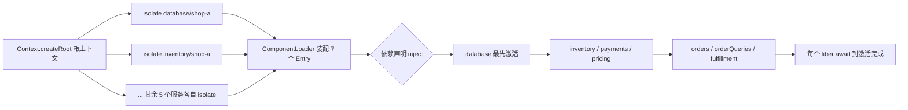
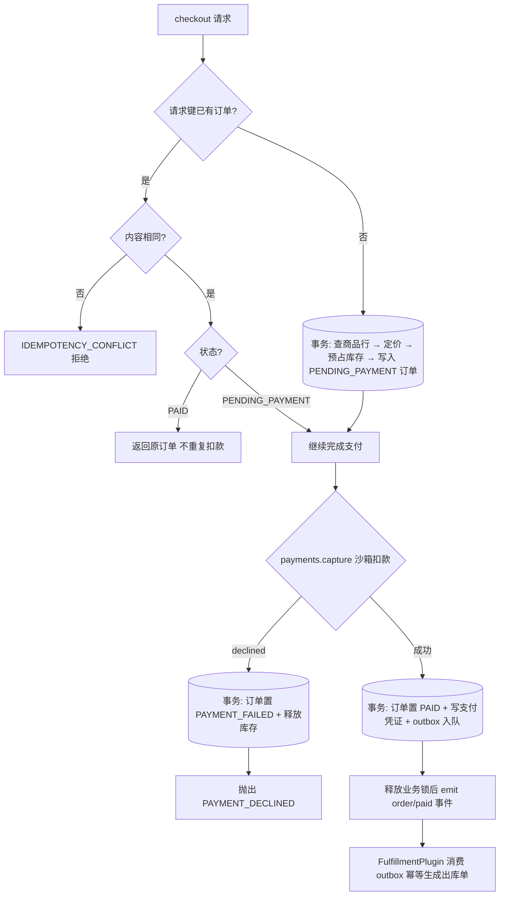

本页面向初学者，带你实际运行 `cordis-example` 中的多租户电商结算示例，并沿着一次"下单 → 支付 → 出库"的完整业务流程，理解 Cordis 的插件组装、依赖激活、幂等与补偿机制是如何落地的。上一页你已经创建了第一个插件，本页则展示多个插件协作时框架的真实价值。

## 一、如何运行

在仓库根目录执行以下命令即可启动演示程序：

```sh
mvn test
mvn install
mvn -pl cordis-example exec:java
# 指定数据目录，便于运行后查看或再次打开；相同演示请求键会复用原订单
mvn -pl cordis-example exec:java -Dexec.args="/tmp/my-commerce-demo"
```

不传参数时会创建一个临时数据目录，结束时打印其路径；目录下会生成 `shop-a.yaml` 和 `shop-b.yaml` 两个独立店铺的数据快照，旁边的 `.lock` 文件用于阻止两个数据库会话同时覆盖同一份数据。程序输出是已经执行并校验过的业务结果，例如首次下单金额、重复提交的去重提示、支付拒绝后的库存释放说明等。

Sources: [README.md](cordis-example/README.md#L5-L33)

入口类是 [Main.java](cordis-example/src/main/java/dev/cordis/example/Main.java#L14-L17)：它先创建根上下文 `Context.createRoot()`，然后为两个租户各打开一个 `CommerceApplication`（try-with-resources 保证关闭），最后 `root.fiber().dispose()` 释放所有运行资源。

## 二、插件阵容与职责

示例由 7 个业务插件组成，每个插件只做一件事：在 `apply` 中组装服务、声明依赖、登记资源和订阅事件。业务规则放在 `service` 包，不可变领域数据在 `domain/Commerce.java`，本地持久化适配器在 `persistence/CommerceDatabase.java`。

| 插件 | 业务职责 | Cordis 机制的实际作用 |
|---|---|---|
| DatabasePlugin | 管理租户数据文件和独占文件锁 | 用 effect 管理会话，卸载释放锁，不删除业务数据 |
| InventoryPlugin | 商品目录、库存预占和释放 | 依赖数据库，库存和订单状态在同一事务内变更 |
| PaymentPlugin | 沙箱扣款、支付幂等和退款凭证 | 停用后依赖它的结算自动进入 PENDING |
| StandardPricingPlugin / MemberPricingPlugin | 原价结算、金卡满额优惠 | 热替换促销策略，历史报价保持不变 |
| OrderPlugin | 下单编排、重复请求识别、支付失败补偿、取消订单 | 卸载使旧服务引用拒绝新业务写入 |
| OrderQueryPlugin | 历史订单查询 | 只依赖数据库，支付维护不影响查询 |
| FulfillmentPlugin | 消费订单 outbox，幂等生成出库单 | 事件监听随插件移除；重新启用时补处理积压任务 |

Sources: [README.md](cordis-example/README.md#L35-L49)

## 三、组装流程：从租户隔离到依赖激活

`CommerceApplication` 是"租户级组合器"，构造时做了两件关键的事。第一，按 7 个服务名逐一调用 `scope.isolate(service, tenantId)`，为每个服务创建以租户 ID 命名的私有域，实现两个店铺的数据隔离。第二，创建 `ComponentLoader` 并用 switch 把配置项 id 映射到插件实例。



注意 `reconcile()` 中的 Entry 列表故意把消费者（orders）写在提供者（database）前面——**激活顺序由 `inject()` 依赖声明驱动，而非列表顺序**。装配完成后逐个 `fiber.await()` 等待全部插件就绪。运营操作（停用支付、热替换促销、审计视图）都映射为"修改 Entry 后重新 reconcile"这一个动作。

Sources: [CommerceApplication.java](cordis-example/src/main/java/dev/cordis/example/CommerceApplication.java#L16-L40)

各插件的依赖声明非常简短，例如 `OrderPlugin.inject()` 返回 `database, inventory, payments, pricing`，并在 `apply` 中取到这些服务组装 `OrderService`，还顺手执行 `recoverPendingPayments()` 恢复上次中断的待支付订单。

Sources: [OrderPlugin.java](cordis-example/src/main/java/dev/cordis/example/plugins/OrderPlugin.java#L9-L21)

## 四、一次下单的完整业务流程

`OrderService.checkout()` 是核心编排器，下面是它的完整流程图：



几个初学者最值得注意的设计点：

**幂等**：相同请求键和相同内容返回原订单；相同键提交不同内容抛 `IDEMPOTENCY_CONFLICT`。金额使用整数分，折扣四舍五入计算，历史订单金额永不因促销热替换而改变。

**补偿**：购物车任一商品库存不足，整笔预占事务不提交；支付拒绝则保留失败订单并在同一事务内释放库存。若扣款成功但提交 PAID 失败，重启后 `recoverPendingPayments()` 会用同一支付凭证恢复，绝不重复扣款。

**事件与锁的顺序**：`checkout` 在 `synchronized` 块内完成所有状态变更，**释放锁之后才 emit `order/paid` 事件**，避免生命周期卸载被事件处理阻塞。

Sources: [OrderService.java](cordis-example/src/main/java/dev/cordis/example/service/OrderService.java#L40-L93)

取消订单遵循同样的显式状态机：仅允许取消已支付且未出库的订单，退款、库存释放和 outbox 撤除在同一事务内只执行一次；已出库订单抛 `ALREADY_FULFILLED`，要求走售后流程。

Sources: [OrderService.java](cordis-example/src/main/java/dev/cordis/example/service/OrderService.java#L95-L107)

## 五、Main 演示脚本逐段解读

`Main.main` 就是一份"可执行的需求说明书"，每个段落验证一种可观察的业务行为：

| 演示段落 | 操作 | 验证的行为 |
|---|---|---|
| 首次下单 + 重复提交 | 相同 `checkout-001` 提交两次 | 返回同一订单，不重复扣库存/扣款 |
| 支付拒绝 | 使用 `declined` 卡号下单 | 记为 PAYMENT_FAILED，库存已释放 |
| 审计权限 | 用 `intercept("orders", readOnly=true)` 视图下单 | 抛 READ_ONLY，可查不可写 |
| 支付维护 | `paymentEnabled(false)` 再恢复 | 结算暂停、查询照常、历史订单不丢 |
| 促销热替换 + 仓配暂停 | 替换为 MemberPricingPlugin、停用 fulfillment | 新订单优惠 ¥13.60、旧订单不变、outbox 积压后补处理 |
| 租户隔离 | 店铺 B 用相同请求键下单 | 价格 9900 分独立，库存互不影响 |
| 持久化恢复 | 全部插件关闭后重新打开数据文件 | 订单、支付回执、出库单仍保留 |

Sources: [Main.java](cordis-example/src/main/java/dev/cordis/example/Main.java#L20-L70)

其中两个操作值得特别说明。审计权限用的是 `context.intercept("orders", Map.of("readOnly", true))` —— 生成一个携带额外配置的调用者视图，`OrderService.writable()` 读取该配置决定是否放行写操作。支付维护则直接把 `payments` Entry 标记为 disabled 后 reconcile：由于 OrderPlugin 声明了对 payments 的依赖，结算服务会自动进入 PENDING 等待状态，而只依赖 database 的 `OrderQueryService` 完全不受影响。

Sources: [CommerceApplication.java](cordis-example/src/main/java/dev/cordis/example/CommerceApplication.java#L46-L53), [OrderService.java](cordis-example/src/main/java/dev/cordis/example/service/OrderService.java#L109-L116)

## 六、数据与沙箱边界

示例中的支付通道只支持 `test-card`（成功）和 `declined`（拒绝）两个卡号，仓配系统只写本地记录，不会访问真实支付、短信或物流接口。文件存储使用进程内事务与原子快照替换，便于直接观察，但它不代替生产数据库的索引、迁移、备份与故障恢复能力。

框架撤销的只是连接、服务注册和事件监听等**运行资源**——订单和已发生的支付属于业务历史，不会因插件卸载被"撤销"；业务补偿由明确的状态转换和退款规则负责。`CommerceWorkflowTest` 的 16 个集成测试验证了这些业务结果，包括并发重复请求、整单库存回退、支付维护时持续查询、租户事件隔离、真实文件重开与扣款后中断的恢复。

Sources: [README.md](cordis-example/README.md#L55-L75)

## 下一步阅读建议

本页展示了示例"怎么跑、跑出什么"；如果你想深入理解背后的机制，建议按以下顺序继续：

- 想知道插件之间依赖与隔离如何实现 → [电商示例架构：插件职责、服务组装与本地沙箱适配器](23-dian-shang-shi-li-jia-gou-cha-jian-zhi-ze-fu-wu-zu-zhuang-yu-ben-di-sha-xiang-gua-pei-qi)
- 想系统学习生命周期与 await 语义 → [六态生命周期模型：PENDING 到 DISPOSED 的转换与 await 语义](5-liu-tai-sheng-ming-zhou-qi-mo-xing-pending-dao-disposed-de-zhuan-huan-yu-await-yu-yi)
- 想理解 isolate 与 intercept 的原理 → [isolate 与 RealmKey：私有域、共享域与配置合并](10-isolate-yu-realmkey-si-you-yu-gong-xiang-yu-yu-pei-zhi-he-bing)
- 想了解促销热替换的 HMR 机制 → [HmrEngine 事务性替换：模块分类、失败回滚与陈旧条目检测](18-hmrengine-shi-wu-xing-ti-huan-mo-kuai-fen-lei-shi-bai-hui-gun-yu-chen-jiu-tiao-mu-jian-ce)