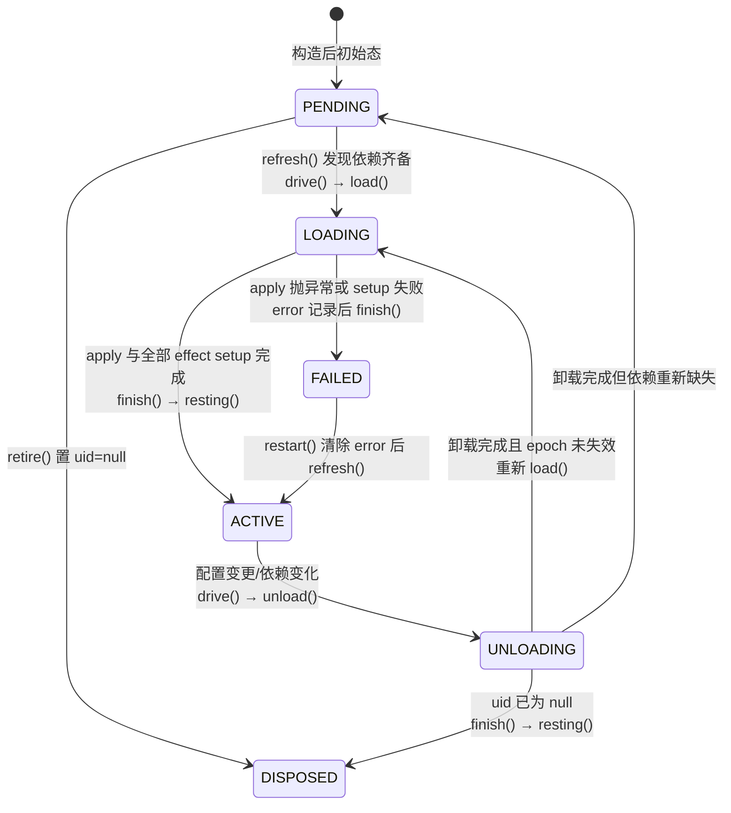

在 cordis-java 中，每一个插件实例都被封装为一个 `Fiber`（运行实例），它的"活着"的过程被建模为一个显式的六态状态机。理解这六个状态之间的转换规则，以及 `await()` 在这套状态机上的语义，是掌握框架启动、失败隔离与热更新行为的基础。本文聚焦于 `FiberState` 枚举定义、状态机的驱动逻辑（`refresh → drive → load/unload → finish`）以及 `await/awaitAsync` 的观察语义。

## 六个状态的定义与职责

六个状态在 [FiberState.java](cordis-core/src/main/java/dev/cordis/core/runtime/FiberState.java#L1-L29) 中被完整定义，每个状态都有明确的单一职责：

| 状态 | 含义 | 关键约束 |
|---|---|---|
| `PENDING` | 待命：依赖的服务尚未就绪，安静等待 | **正常状态**，不是错误 |
| `LOADING` | 加载中：插件主体 `apply` 正在执行 | 过渡态 |
| `ACTIVE` | 运行中：已就绪并对外提供服务 | **唯一能被别人依赖的状态** |
| `FAILED` | 启动失败：apply 或配置校验抛异常 | 错误只记在自己身上，不影响别人 |
| `UNLOADING` | 卸载中：撤销动作按 LIFO 逆序执行 | 过渡态 |
| `DISPOSED` | 已销毁：彻底移除，不能再用 | 终态 |

`PENDING` 的设计哲学值得强调：依赖未就绪被当作"安静地等"而非错误，这使声明式配置树下的组件可以以任意顺序加载，等依赖（通过 `checkImpl`/`refresh` 的依赖检查）就绪后自动激活。

Sources: [FiberState.java](cordis-core/src/main/java/dev/cordis/core/runtime/FiberState.java#L8-L29)

## 状态机全景

状态转换由 `Fiber` 内部的 `drive()` 私有方法统一驱动，所有生命周期变更都被根上下文（root context）串行化（见类注释 "All lifecycle mutations are serialized by the root context"）：

`resting()` 方法是状态归位的裁判：`uid == null` 归为 `DISPOSED`，`error != null` 归为 `FAILED`，否则 `loaded ? ACTIVE : PENDING`。这意味着状态不是被直接"写入"的，而是由事实（uid、error、loaded 标志）推导出来的。

Sources: [Fiber.java](cordis-core/src/main/java/dev/cordis/core/runtime/Fiber.java#L367-L371), [Fiber.java](cordis-core/src/main/java/dev/cordis/core/runtime/Fiber.java#L1-L4)

## 驱动流程：refresh → drive → load/unload

**refresh()** 是状态机的入口触发器。它根据 `pendingStore` 中各注入依赖是否齐备计算出一个摘要（digest，由 revision 与每个依赖的 `Impl.uid` 拼接而成）：任一依赖缺失则 `target = INACTIVE`；否则 target 为依赖指纹。仅当 `error == null` 且 `epoch != target` 时才更新 epoch 并调用 `drive()`——依赖指纹变化（依赖被替换/更新）同样会触发重载。

**drive()** 做三件事：防止重入（`running` 标志）；若实例已失活且无遗留 effect 记录，直接归位为 `resting()`；否则新建一个 `stable` CompletableFuture 作为"本轮收敛"信号，并根据是否已加载决定走 `unload()` 还是 `load()`。

**load()** 中发生了几次关键的状态写入：先对非本 fiber 的依赖调用 `impl.retain(this)`（所有权保留），然后 `setState(FiberState.LOADING)`，随后执行 `plugin.apply(ctx, config)` 并将返回值通过 `collect()` 收集为可撤销 effect。apply 返回后，它还会等待**所有显式 effect 的 setup 完成**（`CompletableFuture.allOf(setups)`），因为 "Explicit effects may still be setting up after apply returns"。只有全部就绪才 `finish()`；任一 setup 失败则记录 `error`、将 epoch 置回 `INACTIVE`，然后走 `unload()` 回退已产生的副作用。

**unload()** 先 `setState(FiberState.UNLOADING)`——注释强调 "publish departure before waiting or invoking any inverse"，即**先对外宣告离开**，再等待依赖本 fiber 提供服务的消费者排空（`provisions → Impl::drained`），最后按逆序 `unwind(records)` 撤销全部 effect。若此时 epoch 仍然有效且无错误，会立即重新 `load()`——这就是配置热更新在同一个 Fiber 上"卸载再加载"的闭环。

Sources: [Fiber.java](cordis-core/src/main/java/dev/cordis/core/runtime/Fiber.java#L264-L294), [Fiber.java](cordis-core/src/main/java/dev/cordis/core/runtime/Fiber.java#L296-L347), [Fiber.java](cordis-core/src/main/java/dev/cordis/core/runtime/Fiber.java#L349-L365)

## 状态变更的通知：internal/status 事件

`setState()` 不仅仅是赋值。每次状态真实发生变化时，它会通过事件系统发出 `"internal/status"` 事件，携带旧状态作为参数；更重要的是，当进入或离开 `ACTIVE` 状态时，会遍历本 fiber 的所有 `provisions` 并通知对应的 ReflectService 重新检查依赖者——这正是 `PENDING` 状态的 fiber 能被"唤醒"的机制：当上游 fiber 变为 `ACTIVE`（或离开 `ACTIVE`），所有依赖它的 fiber 会收到通知并执行 `checkImpl`/`refresh`，重新评估自己是否可以推进状态机。

Sources: [Fiber.java](cordis-core/src/main/java/dev/cordis/core/runtime/Fiber.java#L380-L388), [Fiber.java](cordis-core/src/main/java/dev/cordis/core/runtime/Fiber.java#L249-L262)

## await 语义：观察"稳定点"而非"某一刻"

`await` 家族方法回答的问题是："这个 fiber 什么时候不再动了？"其实现核心在 [Fiber.java](cordis-core/src/main/java/dev/cordis/core/runtime/Fiber.java#L404-L412) 的 `awaitAsync()`：

1. 在根上下文的原子块内同时捕获两个信号：`stable`（本轮 load/unload 是否收敛）与 `updateBarrier`（是否有进行中的异步配置更新）。
2. 两者都完成后**重新进入原子块复核**：若 `running` 又变为 true，或 `updateBarrier` 引用已被替换（说明等待期间又来了新更新），则**递归地重新 await**。
3. 最终收敛时，若 `error == null` 返回 fiber 自身，否则返回以该 error 失败的 future——**失败会传播给等待者**。

这种"复核-重试"循环保证了 await 观察到的是一个**静止点（resting point）**而不是状态机中间的某个瞬间：即使 await 期间发生了多次 update/restart 触发的重载，调用者也只会在最后一轮完全收敛后醒来。

同步版本 `await()` 有一条重要的守卫：若当前正处于某个生命周期回调内部（`root().inRuntime()`）且状态机正在运转，直接 `await()` 会造成死锁（状态机线程在等自己），因此抛出 `IllegalStateException("Use awaitAsync inside a lifecycle callback")`，强制回调内使用异步版本。此外 `update()`/`restart()` 在非运行时上下文中会隐式 `await()`，让调用方拿到结果时状态已经确定；而对应的 `*Async` 变体（`updateAsync`/`restartAsync`）则把"提交变更 + await 收敛"打包为一个 `CompletionStage` 返回。

Sources: [Fiber.java](cordis-core/src/main/java/dev/cordis/core/runtime/Fiber.java#L404-L419), [Fiber.java](cordis-core/src/main/java/dev/cordis/core/runtime/Fiber.java#L421-L473)

## 终态 DISPOSED：retire 与 dispose

`DISPOSED` 通过 `retire()` 达成：将 `uid` 置为 `null`、`target`/`epoch` 置回 `INACTIVE`，然后 `drive()`。此时 `drive()` 检测到实例失活且无遗留记录，直接 `setState(resting())` 归为 `DISPOSED`。`stable` 完成后，fiber 从 `runtime.fibers` 中移除，若运行时已无 fiber 则从注册表中移除整个 runtime。对外则通过 `dispose()/disposeAsync()` 暴露，实际委托给构造时注册在父 fiber 上的 `retireHandle` effect——这保证了销毁动作本身也纳入父级的 LIFO 撤销序列。

Sources: [Fiber.java](cordis-core/src/main/java/dev/cordis/core/runtime/Fiber.java#L475-L494), [Fiber.java](cordis-core/src/main/java/dev/cordis/core/runtime/Fiber.java#L515-L524)

## 与其他机制的关系

- 状态机只负责"何时收敛"，而收敛过程中执行的具体撤销动作（LIFO 逆序、失败不阻断清理）属于效应系统，详见 [效应与资源回退：Disposable、LIFO 逆操作与失败不阻断清理](6-xiao-ying-yu-zi-yuan-hui-tui-disposable-lifo-ni-cao-zuo-yu-shi-bai-bu-zu-duan-qing-li)。
- `PENDING` 的自动激活依赖 `provide`/`get` 的能力检查与 `ReflectService.notify` 通知链，详见 [响应式依赖：provide/get 能力检查与 PENDING 自动激活](8-xiang-ying-shi-yi-lai-provide-get-neng-li-jian-cha-yu-pending-zi-dong-ji-huo)。
- 所有生命周期变更在根上下文上串行化的并发设计，详见 [根上下文串行化与 Fiber 所有权的并发设计](9-gen-shang-xia-wen-chuan-xing-hua-yu-fiber-suo-you-quan-de-bing-fa-she-ji)。
- 配置更新（`update`/`updateBarrier`）的持久化协议，详见 [配置回写与原子写文件：fiber.update 的持久化协议](15-pei-zhi-hui-xie-yu-yuan-zi-xie-wen-jian-fiber-update-de-chi-jiu-hua-xie-yi)。