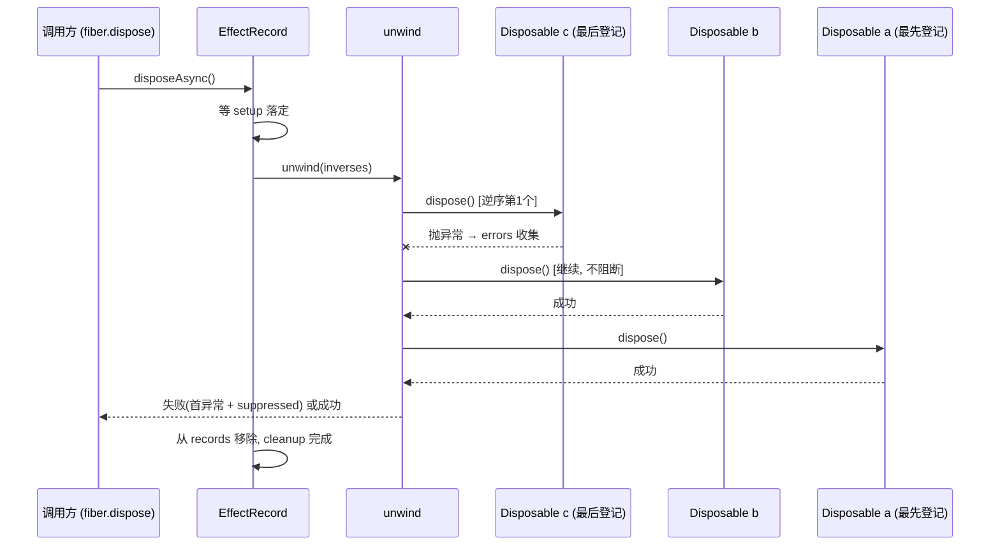

Cordis 的核心承诺是"可回退效应"（论文 §3.1）：组件在运行期间登记的每一个副作用（打开连接、绑定服务、注册监听器）都必须配套一个撤销动作，组件卸载时框架按**后进先出（LIFO）**的顺序执行这些撤销动作，完整还原现场。本页解析三个关键机制：`Disposable` 抽象本身、LIFO 逆操作的登记与执行，以及清理过程中"单个撤销失败不阻断其余清理"的容错设计。

## Disposable：撤销动作的一等公民

`Disposable` 是一个单方法函数式接口，语义是"描述之前做的某件事怎么被收回"。框架保证 `dispose()` 只被调用一次，调用方无需担心重复执行。它还提供了组合代数：`noop()` 是幺元（组合时的"零"），`composeAfter` 把新登记的动作"垫"到已有动作前面，`sequence` 顺序执行两个动作——正是 `composeAfter` 的垫前语义，让多个撤销动作在组合后自然形成 LIFO 回滚顺序。

Sources: [Disposable.java](cordis-core/src/main/java/dev/cordis/core/effect/Disposable.java#L1-L41)

## EffectRecord：效应的运行时登记簿

每个效应在 `Fiber` 内对应一个 `EffectRecord`（实现了 `AsyncDisposable`），持有三样东西：诊断用的 `EffectMeta`（效应名 + 嵌套子效应树，见 `metaStack` 在 `Fiber.effect` 中的 push/pop）、逆操作列表 `inverses`，以及两个阶段屏障——`setup`（效应体是否执行完成）和 `cleanup`（撤销是否执行完成）。`armed` 标志用于多阶段效应的"检查点"：一旦开始卸载（`armed = false`），惰性迭代器停止推进，只回滚已完成登记的部分。

卸载入口 `disposeAsync()` 是幂等的（`cleanup != null` 直接返回），它先等 `setup` 落定（无论成败），再触发 `unwind(inverses)`，最后把自己从 owner 的 `records` 中移除。这解释了测试中的行为：显式 `dispose()` 两次，第二次是 no-op；已释放的效应不再属于 Fiber，后续 Fiber 卸载不会再触碰它。

Sources: [Fiber.java](cordis-core/src/main/java/dev/cordis/core/runtime/Fiber.java#L114-L152)

## effect()：同步失败立即局部回滚

`Fiber.effect(callback, label)` 是登记效应的唯一入口。它先做活性检查（`assertActive` + 拒绝 `UNLOADING` 状态下登记），创建 `EffectRecord` 并加入 `records`，然后执行效应体，把返回值交给 `collect` 收集逆操作。关键在失败路径：如果效应体抛出异常或 `setup` 异常完成，**框架立即调用 `record.disposeAsync()` 回滚该效应已登记的部分逆操作**，而不是留下半开状态——这是"部分失败也要还原现场"的体现。

`EffectCallback` 的返回值有四种形态：单个 `Disposable`（单阶段效应）、`null`（无可撤销物）、`CompletionStage`/`AsyncEffect`（异步，下一页主题）、以及 `Iterable<Disposable>`（多阶段效应）。`flatten` 和 `collect` 对非法类型（既不是 Disposable 也不是 Iterable）抛 `IllegalArgumentException`，对 `Iterable` 中的 `null` 元素静默跳过。

Sources: [Fiber.java](cordis-core/src/main/java/dev/cordis/core/runtime/Fiber.java#L154-L206), [EffectCallback.java](cordis-core/src/main/java/dev/cordis/core/effect/EffectCallback.java#L1-L50)

## unwind：LIFO 逆序与失败不阻断

`unwind` 是 LIFO 语义和容错设计的核心实现：

```java
for (int i = copy.size() - 1; i >= 0; i--) {   // 逆序遍历
    task = task.thenCompose(v -> root().atomic(() -> Stages.dispose(disposable)))
               .handle((v, e) -> {
                   if (e != null) errors.add(Stages.cause(e));  // 吞掉异常，继续下一个
                   return null;
               });
}
```

三个设计要点：

1. **先拷贝再清空**：`unwind` 拷贝 `inverses` 后立即清空原列表，保证清理过程是单次的、不会被并发登记干扰。
2. **链式串行 + 逆序**：每个 `dispose` 通过 `thenCompose` 串在前一个之后，顺序是最后登记的先执行——"先打开的连接最后关闭"。
3. **失败收集而非中断**：`handle` 把每个失败的异常收集进 `errors` 列表，链条继续走完。全部执行完后，第一个异常作为主异常抛出，其余通过 `addSuppressed` 附加。也就是说，一个 `dispose` 抛异常**不会阻断**其他逆操作的执行，但失败最终会传播给调用方（cleanup future 异常完成）。

`Stages.dispose` 是单次执行的防御层：它把同步 `dispose()` 抛出的任何 `Throwable` 转成失败的 `CompletionStage`（而非让异常逃逸打断链条），并且如果 disposable 实际是 `AsyncDisposable`，则委托给 `disposeAsync()`——这是同步/异步两种撤销动作的统一入口。



Sources: [Fiber.java](cordis-core/src/main/java/dev/cordis/core/runtime/Fiber.java#L224-L243), [Stages.java](cordis-core/src/main/java/dev/cordis/core/effect/Stages.java#L27-L36)

## 测试验证的行为边界

`EffectTrackingTest` 精确锁定了上述语义：

| 测试场景 | 验证的行为 |
|---|---|
| 登记 a、b、c 后卸载 Fiber | 执行顺序为 `close:c, close:b, close:a`（LIFO） |
| 显式 `dispose()` 两次 | 第二次是 no-op，且该效应脱离 Fiber，后续卸载不再触发 |
| 返回 `Iterable` 三个 Disposable | 多阶段全部收集，仍按 LIFO 回滚 `undo-3 → undo-1` |
| 在已 DISPOSED 的 Fiber 上登记效应 | 抛 `CordisException`（INACTIVE_EFFECT） |
| 回调返回 `null` | 合法，等价于"没有需要撤销的东西" |

Sources: [EffectTrackingTest.java](cordis-core/src/test/java/dev/cordis/EffectTrackingTest.java#L42-L116)

## 效应树与诊断

每个 `EffectRecord` 的 `EffectMeta` 记录效应的可读 label（如 `ctx.provide("name")`），效应体执行期间嵌套登记的子效应通过 `metaStack` 挂到当前栈顶效应的 `children` 上，形成一棵诊断树。`Fiber.getEffects()` 返回顶层元数据列表，`render()` 可打印缩进文本——当卸载失败需要排查"哪个逆操作出了问题"时，这棵树就是现场地图。

Sources: [EffectMeta.java](cordis-core/src/main/java/dev/cordis/core/effect/EffectMeta.java#L1-L32), [Fiber.java](cordis-core/src/main/java/dev/cordis/core/runtime/Fiber.java#L245-L247)

## 与框架其他部分的衔接

- **provide 的撤销也是效应**：`Fiber.provide` 内部调用 `effect(...)`，其返回的逆操作做服务解绑（`unbind` + 通知 + 排空），因此服务注册同样遵循 LIFO 回退——先注册的依赖后撤销，符合"依赖者先于提供者清理"的直觉。
- **根上下文的结构性效应**：`Fiber` 构造时在父 Fiber 上登记 `ctx.plugin()` 效应，逆操作是 `this::retire`，所以"插件组件的销毁"本身就是一条可回退效应；`transferOwnership` 还支持在托管条目迁移时**转移而不执行**这条结构性逆操作。
- **失败不阻断的边界**：框架保证"清理链条不中断 + 异常如实上报"，但不保证业务侧逆操作本身的正确性——这正是 [论文前提与语义边界：框架不保证的回退正确性](27-lun-wen-qian-ti-yu-yu-yi-bian-jie-kuang-jia-bu-bao-zheng-de-hui-tui-zheng-que-xing) 讨论的主题。

建议的后续阅读：异步形态的效应（`CompletionStage` 返回值、`AsyncEffect` 迭代与 `AsyncDisposable`）见 [异步效应：CompletionStage、AsyncEffect.next 与 AsyncDisposable](7-yi-bu-xiao-ying-completionstage-asynceffect-next-yu-asyncdisposable)；本页机制所处的六态生命周期上下文见 [六态生命周期模型：PENDING 到 DISPOSED 的转换与 await 语义](5-liu-tai-sheng-ming-zhou-qi-mo-xing-pending-dao-disposed-de-zhuan-huan-yu-await-yu-yi)。