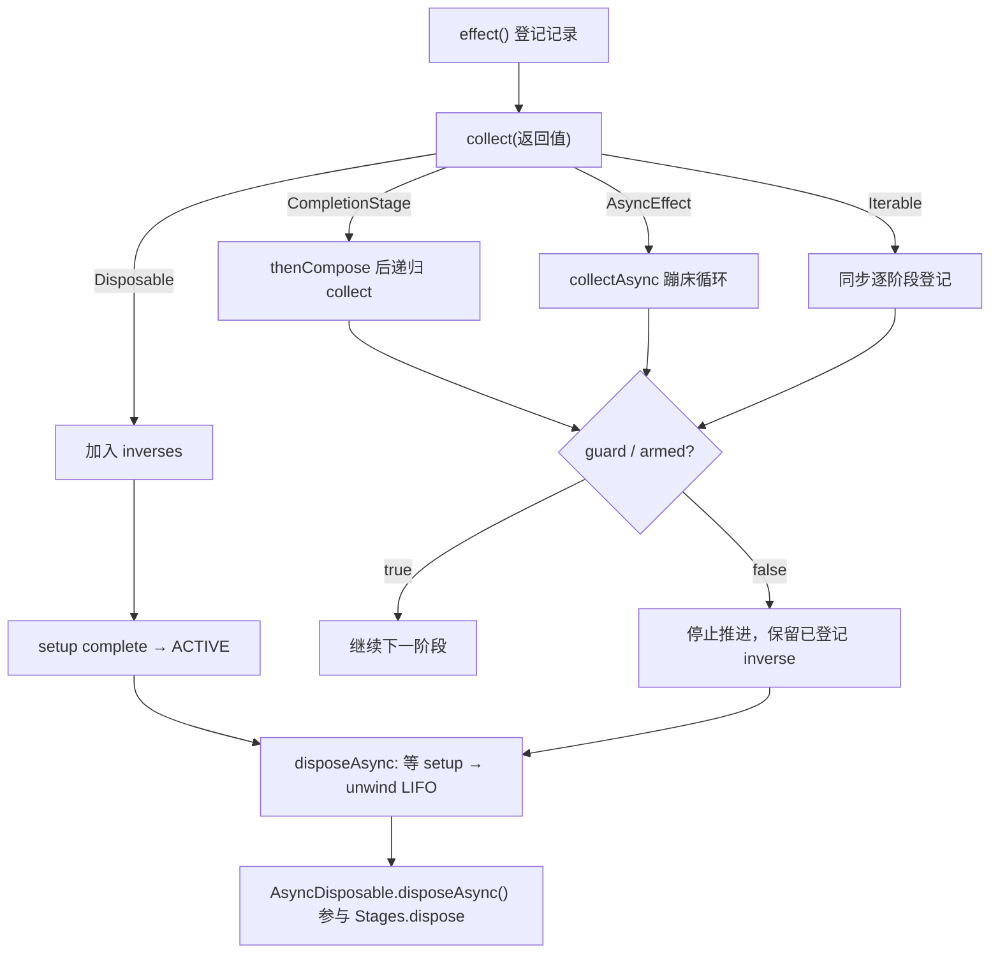

效应系统并不要求启动与清理是同步的。当插件的 apply 回调返回一个 `CompletionStage`、一个 `AsyncEffect` 迭代器、或一个 `AsyncDisposable` 时，Fiber 会把这些异步操作编织进六态生命周期：**setup 未完成则停留在 LOADING，cleanup 未完成则停留在 UNLOADING**。本页解释这三类异步效应的接口契约、Fiber 内部的收集与回退机制，以及异步阶段之间的检查点守卫语义。

## 三类异步返回值与统一收集入口

效应回调 `EffectCallback.execute(ctx)` 允许返回四种东西：`Disposable`、`null`、`CompletionStage`（异步阶段）或 `AsyncEffect`（异步迭代），以及一个 `Iterable<Disposable>` 多阶段列表。同步返回值由 `flatten` 整理，而异步返回值被显式声明为“由 Fiber 的运行器处理”——即 [Fiber.java](cordis-core/src/main/java/dev/cordis/core/runtime/Fiber.java#L154-L182) 中的 `collect`。

`collect` 是一个类型分发器：`Disposable` 直接登记到撤销列表；`null` 立即完成；`CompletionStage` 会 `thenCompose` 到下一步——用阶段完成后的结果递归调用自身，这意味着**回调可以先做异步准备工作，再在完成后返回真正的 `Disposable`**；`AsyncEffect` 则进入专用的 `collectAsync` 驱动循环。任何其他类型都会抛出 `IllegalArgumentException`，这是效应系统的严格契约。

Sources: [EffectCallback.java](cordis-core/src/main/java/dev/cordis/core/effect/EffectCallback.java#L1-L50), [Fiber.java](cordis-core/src/main/java/dev/cordis/core/runtime/Fiber.java#L184-L206)

## CompletionStage：延迟完成的 setup 与生命周期屏障

当插件回调返回 `CompletionStage` 时，Fiber 并不等待它完成才返回——`effect()` 方法立即登记一个 `EffectRecord` 并返回句柄。真正起作用的是 `EffectRecord.setup` 这个 `CompletableFuture`：只有当收集任务 `whenComplete` 成功后它才 complete，而 `disposeAsync` 会先 `handle` 掉 setup 的结果再执行回退，保证**清理永远等 setup 序列化**。

生命周期层面的效果在测试中体现得非常直观：插件回调返回一个未完成的 future 时，Fiber 停在 `LOADING` 状态，`awaitAsync()` 不会完成；直到 future 以一个 `AsyncDisposable` 完成，Fiber 才转为 `ACTIVE`。反过来，dispose 时如果 cleanup future 未完成，Fiber 停在 `UNLOADING`，`disposeAsync()` 挂起直至 cleanup 完成。此外，`ctx.effect(x -> setup)` 内部产生的异步效应同样会阻塞父 Fiber 的激活——异步 setup 是可传递的激活屏障。

Sources: [Fiber.java](cordis-core/src/main/java/dev/cordis/core/runtime/Fiber.java#L117-L152), [AsyncLifecycleTest.java](cordis-core/src/test/java/dev/cordis/AsyncLifecycleTest.java#L17-L34), [AsyncLifecycleTest.java](cordis-core/src/test/java/dev/cordis/AsyncLifecycleTest.java#L183-L194)

## AsyncEffect.next：异步生成器与栈安全的蹦床

`AsyncEffect` 是一个 `@FunctionalInterface`：每次调用 `next()` 返回 `CompletionStage<Step>`，`Step` 携带本阶段的 `inverse` 撤销动作和 `done` 标志，`null` 步或 `done=true` 终止迭代。这相当于把 JavaScript 的异步生成器翻译成 Java 的拉取式协议——每一步的 inverse 在产生时立即登记，即使迭代尚未结束，已完成的部分也可以被回退。

`collectAsync` 的实现有两个关键细节。其一是**蹦床**：如果 `next()` 返回的 future 已经完成，就在 `while` 循环里同步消费，避免一个纯同步的长生产者通过递归 `thenCompose` 撑爆调用栈；只有遇到真正未完成的 future 才切到异步续体。其二是**守卫（guard）**：循环条件是 `guard.getAsBoolean()`，对应 `EffectRecord.armed` 标志——一旦所有者开始卸载（`disposeAsync` 将 `armed` 置 false），迭代立即停止，尚未拉取的步骤不再前进。

Sources: [AsyncEffect.java](cordis-core/src/main/java/dev/cordis/core/effect/AsyncEffect.java#L1-L16), [Fiber.java](cordis-core/src/main/java/dev/cordis/core/runtime/Fiber.java#L208-L222)

## 检查点守卫：异步步骤间的陈旧视图检测

守卫不只是性能优化，而是正确性机制。测试 `asyncIteratorRetainsLateInverseThenStops` 展示了完整时序：消费者 Fiber 挂起在一个未完成的 `next()` 上时，提供者 Fiber 开始 dispose——此时 `armed` 被翻转为 false，但**已在飞行中的那个步骤完成后，其 inverse 仍会被登记并回退**（`step.inverse() != null` 无条件入列表），然后迭代才停止，消费者回到 `PENDING` 状态。也就是说：守卫阻止的是“推进到下一个陈旧步骤”，而不是“丢弃已承诺的资源”。

同样的语义也存在于同步 `Iterable` 分支：源码注释明确写道“在推进惰性迭代器之前先测试守卫，已完成的步骤的 inverse 总是保留”。这保证了`部分启动`在失败或失效时只回滚已完成的部分，与 [效应与资源回退：Disposable、LIFO 逆操作与失败不阻断清理](6-xiao-ying-yu-zi-yuan-hui-tui-disposable-lifo-ni-cao-zuo-yu-shi-bai-bu-zu-duan-qing-li) 中描述的 LIFO 逆操作一致——异步只是把“阶段”的边界从同步返回值扩展到了 future 完成点。

Sources: [Fiber.java](cordis-core/src/main/java/dev/cordis/core/runtime/Fiber.java#L193-L204), [AsyncLifecycleTest.java](cordis-core/src/test/java/dev/cordis/AsyncLifecycleTest.java#L133-L154)

## AsyncDisposable：把异步清理纳入生命周期

`AsyncDisposable` 继承自 `Disposable`，新增 `disposeAsync()` 返回 `CompletionStage<Void>`，并把同步 `dispose()` 默认实现为阻塞等待异步结果（`join`）。`Stages.dispose` 是所有清理路径的统一入口：如果资源是 `AsyncDisposable` 就取其异步句柄，否则同步调用 `dispose()` 并包装成已完成的 stage，异常则转为 `failedFuture`。

它的核心价值在于**清理的完成时间成为 Fiber 生命周期的一部分**。`EffectRecord` 自身就实现了 `AsyncDisposable`：其 `disposeAsync` 构造一个 cleanup future，先等待 setup（无论成败），再通过 `unwind` 按逆序逐个释放 inverse。`unwind` 把每个清理步骤用 `thenCompose` 串联成链，并用 `handle` 收集所有异常——**一个清理失败不会阻断后续清理**，最终把第一个异常与被抑制的其余异常一起抛出。这也正是依赖图中“消费者异步清理完成前，提供者不执行清理、且视图保持提交状态”这类语义的底层支撑。

Sources: [AsyncDisposable.java](cordis-core/src/main/java/dev/cordis/core/effect/AsyncDisposable.java#L1-L14), [Stages.java](cordis-core/src/main/java/dev/cordis/core/effect/Stages.java#L26-L31), [Fiber.java](cordis-core/src/main/java/dev/cordis/core/runtime/Fiber.java#L129-L152), [Fiber.java](cordis-core/src/main/java/dev/cordis/core/runtime/Fiber.java#L224-L243)

## 整体流程与概念关系

| 返回类型 | 收集方式 | 对激活的影响 | 失效时的行为 |
|---|---|---|---|
| `Disposable` | 立即登记 | 无 | LIFO 回退 |
| `CompletionStage` | 完成后以结果递归收集 | 阻塞至 future 完成 | setup 失败触发自动回退 |
| `AsyncEffect` | 蹦床驱动 `next()` 迭代 | 阻塞至迭代终止 | 守卫停止推进，保留已完成 inverse |
| `Iterable<Disposable>` | 同步逐项登记 | 无 | 守卫在推进前检查 |
| `AsyncDisposable`（作为资源） | 由 `Stages.dispose` 识别 | — | 异步清理纳入 unwind 链 |

理解了同步与异步效应如何统一到同一套 setup/cleanup 屏障之后，下一步自然要问：这些屏障由谁触发、何时驱动状态机——这正是 [响应式依赖：provide/get 能力检查与 PENDING 自动激活](8-xiang-ying-shi-yi-lai-provide-get-neng-li-jian-cha-yu-pending-zi-dong-ji-huo) 与 [根上下文串行化与 Fiber 所有权的并发设计](9-gen-shang-xia-wen-chuan-xing-hua-yu-fiber-suo-you-quan-de-bing-fa-she-ji) 要回答的问题。