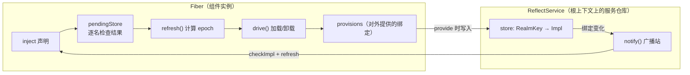
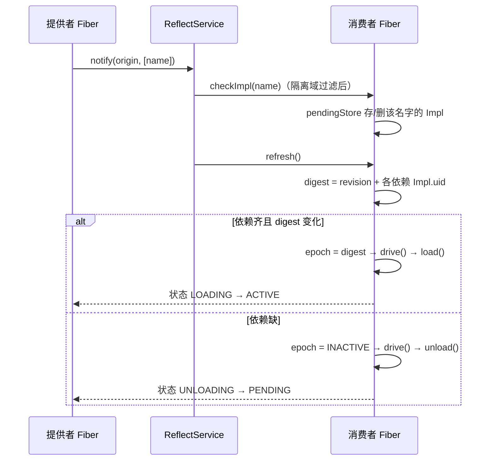

cordis-java 的服务依赖不是"启动时手动装配"，而是**响应式**的：插件声明 `inject()` 需要哪些服务名，框架持续监测这些绑定的可用性——依赖齐了自动启动（PENDING → ACTIVE），缺了自动卸载回 PENDING。本页拆解三件事：`provide` 如何注册绑定、`get` 如何做能力检查、`notify → checkImpl → refresh → drive` 这条广播链如何驱动 PENDING 自动激活。

## 三个角色：Plugin 声明、Fiber 承载、ReflectService 广播

一个 Plugin 只需说清三件事：**需要什么**（`inject()` 返回服务名列表）、**提供什么**（`apply` 里 `ctx.provide`）、**做什么**（`apply` 主体）。同一个插件配不同 config 就是两个实例。



服务绑定 `Impl` 挂在**根上下文**的 `ReflectService.store` 中，按隔离域 `RealmKey` 分 key——同一个服务名在不同隔离域可各有一条绑定。`Impl` 携带提供者 fiber、值、可用性 `check` 谓词，以及依赖方保留集合 `dependents`（用于卸载时的排水 `drained()`）。

Sources: [Plugin.java](cordis-core/src/main/java/dev/cordis/core/Plugin.java#L13-L29), [ReflectService.java](cordis-core/src/main/java/dev/cordis/core/coeffect/ReflectService.java#L14-L35), [Impl.java](cordis-core/src/main/java/dev/cordis/core/coeffect/Impl.java#L13-L23)

## provide：以效应形式注册，随生命周期自动注销

`ctx.provide(name, value, check)` 最终落到 `Fiber.provide`，它**不是简单写一张表，而是登记为一个 effect**（标签为 `ctx.provide("name")`）。这意味着提供绑定天然继承了效应的 LIFO 回退协议：fiber 卸载或重载时，绑定随效应撤销自动注销。注册流程分四步：

1. **查重**：该隔离域上已有绑定或同名 accessor 时抛 `DUPLICATE_PROVIDE`；
2. **建绑定**：创建 `Impl(name, this, from, key, value, check)` 加入 `provisions` 并 `reflect.bind(key, impl)`；
3. **自用快照**：若自己已加载（`store != null`），同步写进自己的 `store`，让本 fiber 的 `get` 也能读到；
4. **通知**：若提供者已 ACTIVE，立即 `reflect.notify` 广播该名字——正在等待此服务的消费者会被唤醒。

`check` 谓词是"可用性检查"：依赖方加载前会先对候选值问一次 `check.test(candidate)`（例如 `Service` 基类默认注册的就是 `value -> ((Service) value).isAvailable()`），子类通过覆写 `isAvailable()` 实现条件可用（如支付插件维护模式下返回 false）。

Sources: [Fiber.java](cordis-core/src/main/java/dev/cordis/core/runtime/Fiber.java#L530-L556), [Context.java](cordis-core/src/main/java/dev/cordis/core/runtime/Context.java#L283-L291), [Service.java](cordis-core/src/main/java/dev/cordis/core/coeffect/Service.java#L18-L27)

## get：能力检查——你能用什么服务，声明 inject 那一刻就定死了

`ctx.get(name)` 是消费侧入口，核心规则是**沿 fiber 链向上查找第一个"加载时拿到过该服务"的祖先 fiber**，查找过程中同时做两级能力检查：

| 情况 | 判定条件 | 结果 |
|---|---|---|
| 自己或祖先的 `store` 快照里有该绑定 | `f.store.get(name)` 命中且隔离域匹配 | 返回值（经 `contextualize` 适配） |
| 声明了但没拿到 | 当前 fiber `inject.containsKey(name)` 但 store 无绑定 | `INACTIVE_ACCESS` 异常 |
| 压根没声明 | 沿链到根都没声明 | `UNDECLARED_ACCESS` 异常（越权） |
| 隔离域边界 | 父 fiber 解析同一名字落在不同 RealmKey | `UNDECLARED_ACCESS`（realm boundary） |

三点值得注意。第一，查找基于**加载时快照**（`store` 是 `load()` 时从 `pendingStore` 复制的 `LinkedHashMap`），而非实时查询全局绑定表——这保证了 `apply` 执行期间看到的依赖集合与驱动本轮加载的依赖集合一致。第二，**根上下文（`runtime == null`）不受能力约束**，直接按非严格模式查绑定表，方便应用外壳取服务。第三，`getOrNull` 提供**不声明检查**的宽松读取：没有或提供者未就绪返回 null，而不是抛异常。

Sources: [Context.java](cordis-core/src/main/java/dev/cordis/core/runtime/Context.java#L29-L33), [Context.java](cordis-core/src/main/java/dev/cordis/core/runtime/Context.java#L195-L239), [Fiber.java](cordis-core/src/main/java/dev/cordis/core/runtime/Fiber.java#L358-L363)

## PENDING 自动激活：notify → checkImpl → refresh → drive

响应式的引擎是一条四步广播链。绑定一有变化（provide/withdraw、提供者 ACTIVE 状态翻转），`ReflectService.notify` 就被触发：



各步骤语义：

- **checkImpl(name)**：在根锁内重新解析该名字的绑定（strict 模式：提供者必须未撤回且处于 ACTIVE）。命中且通过 `check` 则放入 `pendingStore`，否则移除。检查抛异常也会移除——**不可用即缺失**，不会让消费者卡死。
- **refresh()**：重算激活目标。若 `inject` 里每个名字在 `pendingStore` 都有条目，digest 为 `revision + 各 Impl.uid 拼接`，否则为 `INACTIVE`。digest 与当前 `epoch` 不同就 `drive()`——注意 digest 里包含依赖的 `uid`，**同一服务的提供者换人也会触发重载**。
- **drive() / load() / unload()**：加载时把 `pendingStore` 复制为快照 `store`，并对外部提供的绑定做 `retain`（记入 `retained`，持有 `Impl.dependents`）；卸载时先等 `provisions` 的 `drained()`（依赖方释放后才回退），再 LIFO 逆放效应。全部静止后 `resting()` 给出终态：`uid` 为 null 是 DISPOSED，有 error 是 FAILED，已加载是 ACTIVE，否则就是 **PENDING——"依赖还没齐，安静待命"**。

另一条通知路径在 `setState`：**提供者 ACTIVE 状态翻转时**（`(old == ACTIVE) != (next == ACTIVE)`）会对它 `provisions` 里的每个绑定 `reflect.notify`——这就是"数据库插件下线，所有注入它的插件自动卸载回 PENDING；重启后又自动恢复"的机制。

Sources: [ReflectService.java](cordis-core/src/main/java/dev/cordis/core/coeffect/ReflectService.java#L110-L136), [Fiber.java](cordis-core/src/main/java/dev/cordis/core/runtime/Fiber.java#L258-L285), [Fiber.java](cordis-core/src/main/java/dev/cordis/core/runtime/Fiber.java#L287-L301), [Fiber.java](cordis-core/src/main/java/dev/cordis/core/runtime/Fiber.java#L554-L558)

## 实战验证：消费者先于提供者加载

电商示例刻意让**消费者排在提供者之前**加载，以证明"服务声明驱动激活"而非加载顺序：

```java
// Consumers intentionally precede their providers: service declarations drive activation.
loader.load(List.of(Entry.of("orders", "orders").build(), /* ... */
    Entry.of("database", "database").config(database).build()));
```

`OrderPlugin` 声明注入 `database/inventory/payments/pricing`，但它排第一加载——此时这些绑定尚不存在，`checkImpl` 全部落空、digest 为 `INACTIVE`，fiber 停在 **PENDING**。最后加载的 `DatabasePlugin` 执行 `ctx.provide("database", database)` 时触发 notify，`OrderPlugin` 的 `pendingStore` 逐名补齐、refresh 通过、drive 启动。反向同样成立：`paymentEnabled(false)` 走 reconcile 移除支付插件后，`PaymentPlugin` 撤回绑定并 notify，依赖 `database` 的它卸载，而依赖 `payments` 的下游也随之回到 PENDING——整棵依赖树自动收敛，无需手写任何装配或拆卸代码。

Sources: [CommerceApplication.java](cordis-example/src/main/java/dev/cordis/example/CommerceApplication.java#L33-L46), [PaymentPlugin.java](cordis-example/src/main/java/dev/cordis/example/plugins/PaymentPlugin.java#L9-L13)

## 语义边界与延伸阅读

- `await()` 的语义以这条链为基础：PENDING 的 fiber 会阻塞到依赖齐、加载完成或失败（详见 [六态生命周期模型：PENDING 到 DISPOSED 的转换与 await 语义](5-liu-tai-sheng-ming-zhou-qi-mo-xing-pending-dao-disposed-de-zhuan-huan-yu-await-yu-yi)）。
- `provide` 的隔离域解析与 `isolate` 多租户的关系见 [isolate 与 RealmKey：私有域、共享域与配置合并](10-isolate-yu-realmkey-si-you-yu-gong-hiang-yu-gong-xiang-yu-yu-pei-zhi-he-bing)。
- `get` 返回值的 `contextualize` 适配与拦截视图见 [ContextualService 调用者视图：JVM 上拦截的具体类适配方案](11-contextualservice-diao-yong-zhe-shi-tu-jvm-shang-lan-jie-de-ju-ti-lei-gua-pei-fang-an)。
- 绑定撤销时的 `drained()` 排水协议与 LIFO 回退细节见 [效应与资源回退：Disposable、LIFO 逆操作与失败不阻断清理](6-xiao-ying-yu-zi-yuan-hui-tui-disposable-lifo-ni-cao-zuo-yu-shi-bai-bu-zu-duan-qing-li)。