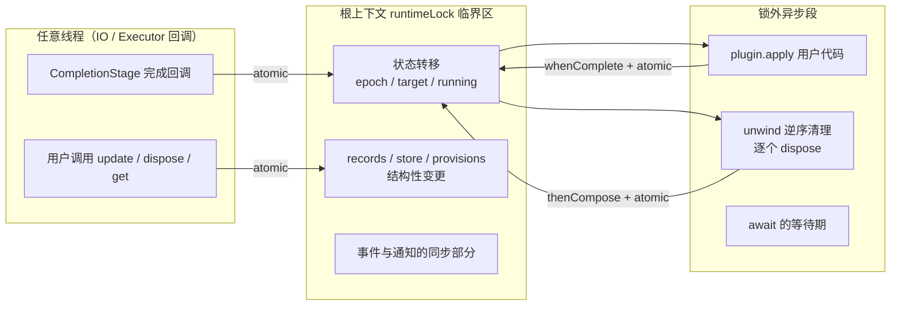
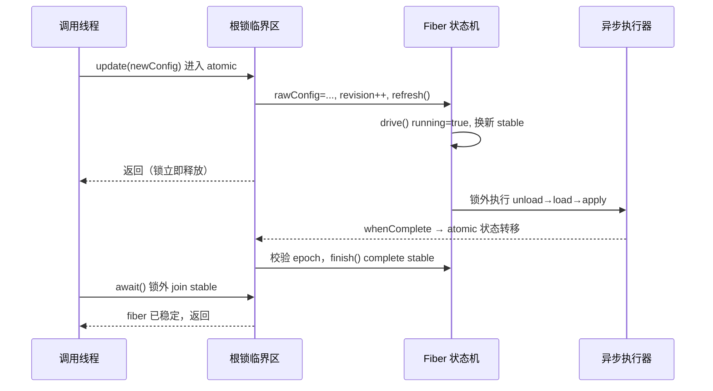

cordis-java 的并发模型可以概括为一句话：**所有运行时结构变更都被一根全局锁串行化，而所有耗时操作都发生在锁外**。本文剖析这套“单锁 + 异步续体”设计如何保证 Fiber（组件实例）在任意执行器回调下依然拥有一致的生命周期语义：谁在锁内推进状态机、谁持有 Fiber 的所有权、`await` 如何不阻塞临界区，以及为什么整棵上下文树只需要一把锁。

## 单一临界区：runtimeLock 与 atomic

整个应用共享一把锁——根上下文的 `runtimeLock`。`Context.atomic` 把一段同步代码包进 `synchronized (rootRef.runtimeLock)`，而 `inRuntime()` 通过 `Thread.holdsLock` 告知调用者“当前线程是否处于临界区内”。注意每个 Context 都持有同一个 `rootRef`，因此无论从子上下文还是根上下文进入，最终都串行到根上的同一把锁（[Context.java](cordis-core/src/main/java/dev/cordis/core/runtime/Context.java#L40-L54)）。

这是一个“上帝锁”策略：应用级框架的可变状态（fiber 状态机、服务注册表、事件分发、附件存储）本质上是一张强耦合的图，用多把细粒度锁反而会引入复杂的锁序协议。cordis 的取舍是：**锁只保护结构性变更，绝不包住用户代码与 I/O**——`atomic` 的注释明确写着 "Never block in this section"（[Context.java](cordis-core/src/main/java/dev/cordis/core/runtime/Context.java#L44-L48)）。每个 `atomic` 调用都是小而快的状态转移，例如读配置快照（[Fiber.java](cordis-core/src/main/java/dev/cordis/core/runtime/Fiber.java#L54-L63)）、登记效应（[Fiber.java](cordis-core/src/main/java/dev/cordis/core/runtime/Fiber.java#L155-L186)）、派发事件（[EventsService.java](cordis-core/src/main/java/dev/cordis/core/runtime/EventsService.java#L84-L88)）。

关键模式是 `whenComplete((v, e) -> root().atomic(...))`：异步完成回调可能来自任意执行器线程，框架在每个异步边界都重新进入临界区做状态转移，而不是让长任务持有锁。这就把“多线程下的状态机”压缩成了“单线程状态机 + 异步挂起点”。

## Fiber 状态机的并发语义：volatile 字段 + running 哨兵

Fiber 的对外可观察状态全部声明为 `volatile`——`uid`、`state`、`target`、`config`、`rawConfig`、`store`，保证无锁读（如日志、监控）能看到最新值；而互斥写入、读改写序列则全部收敛进 `atomic`。非 volatile 的私有字段（`running`、`loaded`、`epoch`、`revision`、`stable`）只在锁内触碰，由锁本身提供可见性（[Fiber.java](cordis-core/src/main/java/dev/cordis/core/runtime/Fiber.java#L21-L50)）。

`drive()` 是状态机的调度入口，`running` 标志在这里充当**可重入防抖哨兵**：如果生命周期转移已经在进行中（`running == true`），后续的 `refresh()` 只会更新 `target`，不会启动第二段加载——正在运行的那段会在自己的完成回调里发现 `epoch` 已变，自动走 `unload()` 再重新 `load()`（[Fiber.java](cordis-core/src/main/java/dev/cordis/core/runtime/Fiber.java#L265-L282)、[Fiber.java](cordis-core/src/main/java/dev/cordis/core/runtime/Fiber.java#L328-L350)）。这解决了经典的“配置热更新到达时旧启动尚未完成”竞态：目标状态先落盘，实际转移串行追赶。

epoch（运行代数）机制与之配套：`load()` 记下启动时的 `startEpoch`，异步完成时若 `epoch` 已不等于 `startEpoch`（期间发生过 update/restart/retire），则不再进入 ACTIVE，而是转入 `unload()`。也就是说，**过期的异步结果被代数检查静默作废**，而不是覆盖新状态（[Fiber.java](cordis-core/src/main/java/dev/cordis/core/runtime/Fiber.java#L294-L350)）。

| 字段 | 声明方式 | 访问协议 |
|---|---|---|
| `state` / `target` / `uid` / `store` / `config` | `volatile` | 锁内写，锁外无锁读 |
| `running` / `loaded` / `epoch` / `stable` | 普通字段 | 仅在 `atomic` 内触碰 |
| `records` / `pendingStore` / `provisions` | 普通集合 | 仅在 `atomic` 内读写 |

## await 语义：不阻塞临界区的稳定等待

`await` 面临一个两难：调用者要等到 fiber 稳定，但“稳定”又由根锁上的状态机定义——如果在锁内直接 join 自己，就会死锁。cordis 的解法分三层：

1. **`stable` future**：每次 `drive()` 开启一段转移时换新，`finish()` 在锁内 complete 它（[Fiber.java](cordis-core/src/main/java/dev/cordis/core/runtime/Fiber.java#L275-L282)、[Fiber.java](cordis-core/src/main/java/dev/cordis/core/runtime/Fiber.java#L385-L391)）。
2. **`updateBarrier`**：`update()` 可能触发组件的异步 `internal/update` 钩子，这个 barrier 挂接其完成阶段，保证 `await` 覆盖“用户钩子尚未返回”的窗口（[Fiber.java](cordis-core/src/main/java/dev/cordis/core/runtime/Fiber.java#L432-L448)）。
3. **递归重读**：`awaitAsync` 在锁内快照 `stable` 与 `updateBarrier`，锁外 join，醒来后再进锁检查——若期间发生了新的转移或 barrier 被替换，就递归重等。这避免了“快照后立刻又 update”的丢信号竞态（[Fiber.java](cordis-core/src/main/java/dev/cordis/core/runtime/Fiber.java#L404-L412)）。

同时有一条硬规则：**在生命周期回调内持有根锁时禁止同步 `await`**——`await()` 会检测 `inRuntime() && running` 并直接抛 `IllegalStateException`，要求改用 `awaitAsync`（[Fiber.java](cordis-core/src/main/java/dev/cordis/core/runtime/Fiber.java#L414-L418)）。同类防死锁逻辑也出现在 `dispose()` / `restart()` / `update()` 中：只有当调用不在临界区内时才同步 join，否则返回让外层异步链处理（[Fiber.java](cordis-core/src/main/java/dev/cordis/core/runtime/Fiber.java#L148-L151)、[Fiber.java](cordis-core/src/main/java/dev/cordis/core/runtime/Fiber.java#L421-L429)）。

## 结构清理的串行化：unwind 与 drained 栅栏

资源回退同样遵守“锁内决策、锁外执行”的纪律。`unwind` 把逆序列表复制后清空，然后为每个 `Disposable` 组一条 `thenCompose(v -> root().atomic(() -> Stages.dispose(disposable)))` 链——每个逆操作的**发起**都在锁内，执行在锁外，错误收集后合并为首异常 + suppressed（[Fiber.java](cordis-core/src/main/java/dev/cordis/core/runtime/Fiber.java#L227-L241)）。

卸载一个 fiber 前，必须先确认它提供的服务不再被任何依赖方使用：`unload()` 先发布 `UNLOADING` 状态，再等待所有 `provisions` 的 `Impl.drained()` future，之后才进锁执行 `unwind(records)`（[Fiber.java](cordis-core/src/main/java/dev/cordis/core/runtime/Fiber.java#L351-L368)；`drained` 语义见 [Impl.java](cordis-core/src/main/java/dev/cordis/core/coeffect/Impl.java#L35-L47)）。提供方撤回服务也遵循同一协议：先标记 `withdrawn` 并通知订阅者，等依赖清空后再真正 unbind（[Fiber.java](cordis-core/src/main/java/dev/cordis/core/runtime/Fiber.java#L530-L547)）。这保证依赖方永远不会观察到“绑定还在但实现已经没了”的中间态。

## 所有权模型：EffectRecord.owner 与 transferOwnership

每条效应记录（包括 `ctx.plugin()` 在根 fiber 上安装的结构性 `retireHandle`）都带一个 `Fiber owner` 字段，决定它挂在谁的 `records` 列表里、随谁的卸载被撤销（[Fiber.java](cordis-core/src/main/java/dev/cordis/core/runtime/Fiber.java#L118-L124)）。当组件加载器把一个受管插件条目在树中移动位置时，并不需要销毁重建——`transferOwnership(nextOwner)` 在锁内把记录从旧 owner 的列表摘下、挂到新 owner，前提是两者共享同一应用根（`nextOwner.root() != root()` 会拒绝），且旧记录确实是根上的结构性 owner（[Fiber.java](cordis-core/src/main/java/dev/cordis/core/runtime/Fiber.java#L496-L514)）。

这是一个**引用型所有权**设计：Fiber 实例本身由 `PluginRuntime.fibers` 集合持有，退出通过 `retire()` 完成——置空 `uid`、驱动 `drive()` 走卸载，最后把自己从 runtime 移除，runtime 空了再从 registry 注销（[Fiber.java](cordis-core/src/main/java/dev/cordis/core/runtime/Fiber.java#L474-L494)）。`retirement` future 幂等化重复 dispose，确保并发的两次 `disposeAsync()` 只触发一次退出。

| 所有权层级 | 持有者 | 释放时机 |
|---|---|---|
| PluginRuntime | RegistryService（`internal` map） | runtime 的最后一个 fiber retire 后 |
| Fiber 实例 | PluginRuntime.fibers | `retire()` 完成 |
| EffectRecord | `record.owner`（可迁移） | owner 卸载时 unwind |
| Disposable 逆操作 | EffectRecord.inverses | LIFO 逆序逐个撤销 |

## 设计取舍总结

这套架构把并发正确性建立在一个不变式上：**根锁内的代码段必须无阻塞、无用户回调**。用户代码（apply、dispose 逆操作、事件监听器）永远在锁外执行，完成时再通过 `atomic` 回到临界区做下一步状态转移。代价是所有应用级变更全局串行——但对以生命周期管理为核心、不存在高频热点写的框架而言，这是用最少的锁复杂度换取最强一致性的合理交换：任何时刻进入临界区，都能看到一张完全一致的依赖图，不需要担心锁序，也不需要为每个集合选择并发容器。

如果想看这套锁之上如何驱动六态生命周期的完整转换，请阅读 [六态生命周期模型：PENDING 到 DISPOSED 的转换与 await 语义](5-liu-tai-sheng-ming-zhou-qi-mo-xing-pending-dao-disposed-de-zhuan-huan-yu-await-yu-yi)；资源逆序回退的细节在 [效应与资源回退：Disposable、LIFO 逆操作与失败不阻断清理](6-xiao-ying-yu-zi-yuan-hui-tui-disposable-lifo-ni-cao-zuo-yu-shi-bai-bu-zu-duan-qing-li)；这些语义在测试中的验证方式见 [测试体系：93 个测试用例覆盖的行为与语义边界](26-ce-shi-ti-xi-93-ge-ce-shi-yong-li-fu-gai-de-xing-wei-yu-yi-bian-jie)。

Sources: [Context.java](cordis-core/src/main/java/dev/cordis/core/runtime/Context.java#L40-L54)
Sources: [Fiber.java](cordis-core/src/main/java/dev/cordis/core/runtime/Fiber.java#L21-L50)
Sources: [Fiber.java](cordis-core/src/main/java/dev/cordis/core/runtime/Fiber.java#L265-L350)
Sources: [Fiber.java](cordis-core/src/main/java/dev/cordis/core/runtime/Fiber.java#L404-L448)
Sources: [Fiber.java](cordis-core/src/main/java/dev/cordis/core/runtime/Fiber.java#L496-L514)
Sources: [Fiber.java](cordis-core/src/main/java/dev/cordis/core/runtime/Fiber.java#L351-L368)
Sources: [FiberState.java](cordis-core/src/main/java/dev/cordis/core/runtime/FiberState.java#L1-L29)
Sources: [EventsService.java](cordis-core/src/main/java/dev/cordis/core/runtime/EventsService.java#L84-L88)